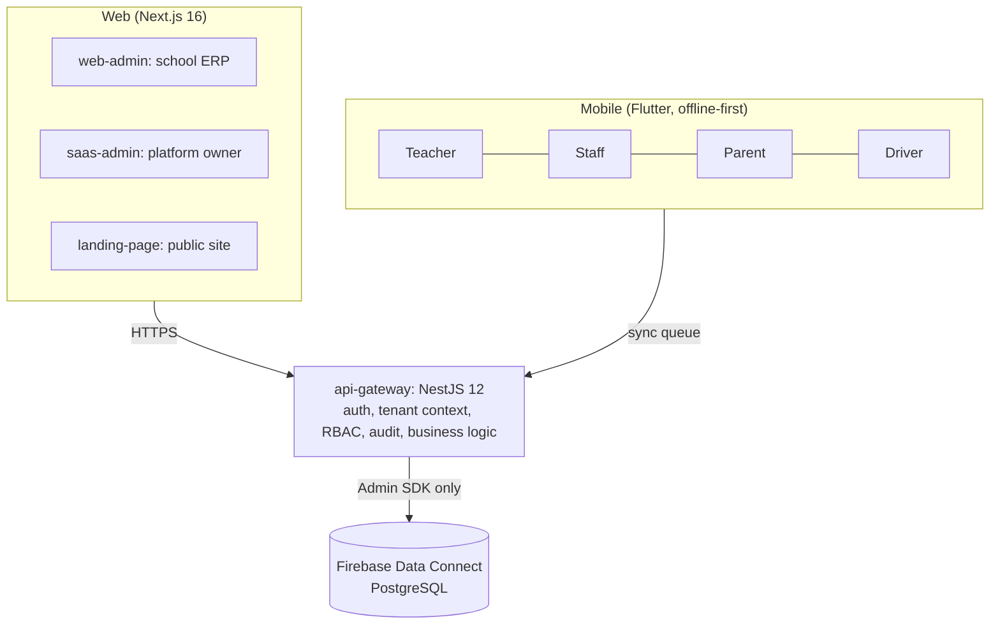

# OruSchools

A multi-tenant school management platform built for schools where the network is unreliable. One calm system replaces paper registers, spreadsheets and WhatsApp groups: admissions, attendance, fees and payroll, timetables and exams, transport, and parent communication. Teachers, parents, drivers and office staff can use it without training, and the mobile apps keep working offline.

> **Status: Phase 0 (foundation) is complete; Phase 1 is next.** The architecture, data model, permissions, design system, language support and quality gates are built and tested. The apps are themed shells with **no school features yet**. See [Roadmap](#roadmap) and [What is and is not built](#what-is-and-is-not-built).

## How it fits together



- **Two pillars:** a web ERP (system of record) and a family of four mobile apps (system of engagement), all sharing one design language.
- **No client ever talks to the database.** Every operation goes through the gateway, which resolves the school from the verified user, checks the role, writes an audit record, and only then calls Data Connect.
- **Multi-tenant by row:** one schema, every tenant table carries a `school` reference, every operation is school-scoped and `NO_ACCESS` to clients. Cross-tenant writes are aborted inside the database (proven by tests).
- **Offline-first mobile:** the phone's local database is the source of truth for the UI; changes go through a sync queue. English is the default language; 18 others are supported, six of them right-to-left.

## Repository layout

| Path | What it is |
|---|---|
| `apps/api-gateway` | NestJS 12 API (port 3000). Scaffold only; guards and modules arrive in Phase 1 |
| `apps/web-admin`, `saas-admin`, `landing-page` | Next.js 16 apps (ports 3002, 3001, 3003), themed and localized shells |
| `apps/mobile-teacher`, `-staff`, `-parent`, `-driver` | Flutter apps, ids `com.oruschools.<role>`, themed and localized shells |
| `packages/rbac` | The 14 roles and the permission matrix (deny by default), with tests |
| `packages/i18n` | 19 languages: registry, message catalogs, generates Flutter/web/CSS/font artefacts |
| `packages/shared-design-tokens` | Builds the design tokens into CSS, a Tailwind v4 theme, TypeScript and Dart |
| `packages/flutter-core` | Dart tokens, theme, localization layer and 12 bundled font families |
| `packages/shared-ui` | React component library (batch 1 of 4 built); styles in `styles.css` |
| `packages/api-client`, `database` | Typed gateway client; generated Data Connect Admin SDK |
| `dataconnect/` | Schema and the `erp-connector` operations |
| `documentation/` | Architecture, decisions (ADRs), design system, brand assets, plans, audit |
| `evals/`, `tools/` | Spec evals, the drift check, emulator tests, asset scripts |

## Getting started

**Prerequisites:** Node 22.22.3 or newer (`nvm use`, see `.nvmrc`; ADR-0008), npm 10, Flutter 3.47+ (Dart 3.13+). Install the Dart tools once: `dart pub global activate melos` and `dart pub global activate flutter_launcher_icons`, and put `~/.pub-cache/bin` on your `PATH`. The Firebase CLI is a local dev dependency (`npx firebase`); **Java is not needed**, the Data Connect emulator runs on PGlite.

```bash
npm install            # JS/TS workspaces
flutter pub get        # Dart pub workspace (all Flutter packages and apps)
```

**Run things**

```bash
npm run dev                                     # the three Next.js apps (3001, 3002, 3003)
npm run start:dev -w api-gateway                # the API on :3000
npx firebase emulators:start --only dataconnect --project demo-oruschools   # database emulator on :9399
cd apps/mobile-teacher && flutter run -d <device>                           # any Flutter app
```

Web apps are served in English at `/` and in other languages under the language code, for example `http://localhost:3002/ur` (Urdu, right-to-left).

## Everyday commands

| Command | What it does |
|---|---|
| `npm run build` / `lint` / `typecheck` / `test` | Turborepo across every JS/TS package and app |
| `melos run analyze` / `melos run test` | All Flutter packages and apps |
| `npm run check:drift` | Docs, config, schema and code checked against each other (see below) |
| `npm run eval` | Drift check plus the spec and invariant evals |
| `npm run test:dataconnect` | Database-level tenant isolation tests on the emulator |
| `npm run test:gateway` | The gateway against the Firebase Auth emulator |
| `npm run test:database` | The gateway data layer (Admin SDK) against the emulator |
| `npm run tokens:build` / `tokens:check` | Regenerate / verify the design-token outputs |
| `npm run i18n:build` / `i18n:check` | Regenerate / verify language artefacts (also runs `flutter gen-l10n`) |
| `npx firebase dataconnect:compile` | Compile the schema and regenerate the Admin SDK (`packages/database/generated`) |

## Quality gates

This project is built with AI coding agents, so it carries automated protection against drift and hallucination:

- **Drift check** (`tools/checks/drift-check.mjs`): paths cited in docs exist; no `PUBLIC` or un-scoped database operations; secrets are ignored; generated files are current; no physical left/right in layout code (breaks right-to-left); no hard-coded UI strings; no dark-mode styles; tracked-but-ignored files.
- **Evals** (`evals/`): schema and role invariants, design-token contrast (WCAG), language and font coverage, and a golden set of questions that grades whether an AI agent stays grounded (`npm run eval:agent -- answers.json`).
- **Mutation-checked tests:** the important guarantees (tenant isolation, role limits, token and language rules) were verified by deliberately breaking them and confirming the tests fail.
- **Independent reviews:** two multi-agent reviews of Phase 0, each finding verified by a separate skeptic; results in `documentation/audit_2026-10-15.md`.
- **CI** (`.github/workflows/periodic-checks.yml`): runs everything above on every push and weekly. **It has not run on GitHub yet**; every step was run locally and in a simulated clean clone.

## Branches and releases

`feat|fix|chore/<app>/<topic>` → `app/<app>` → `staging` → `main` (production); urgent fixes go `hotfix/*` → `main`, then back into `staging`. An app branch may change only its own app (shared code goes through `app/shared`). Enforced by CI; see [ADR-0010](documentation/decisions/ADR-0010-branching-and-environments.md).

## Rules that must not be broken

1. **Tenant isolation:** the school comes from the verified user, never the request body; every database operation takes `$schoolId`.
2. **Roles:** enforced in the gateway on every route, deny by default. Only the Principal approves; only the System Admin grants roles.
3. **No client to database access.** No `PUBLIC` Data Connect operations.
4. **Money is never a float:** integer minor units in `Int64` `*Minor` fields.
5. **Design tokens only:** no raw colours, **light theme only** (no dark mode in v1), icons paired with words, 48 px minimum touch targets (64 px in the Driver app).
6. **Languages:** English is primary; the language is an explicit choice, never auto-detected. All user-visible text comes from `packages/i18n`; logical directions only (`ms-`/`me-`, `EdgeInsetsDirectional`). Translations are drafts until a native speaker reviews them.
7. **Secrets** live only in the gateway's environment, never in a web `NEXT_PUBLIC_*` variable or a mobile build.

The full agent and developer guide is [`CLAUDE.md`](CLAUDE.md).

## Roles and languages

**14 roles** (`packages/rbac`): Principal, Management, Bursar (finance admin), Academic Admin, System Admin, HR Manager, Accountant, Admissions Officer, Transport Manager, Operations Manager, Teacher, Staff, Driver, Parent. Every employee can check in and request their own leave. See [ADR-0007](documentation/decisions/ADR-0007-roles.md).

**19 languages** (`packages/i18n`): English (primary); right-to-left Urdu, Kashmiri, Sindhi, Pashto, Persian, Arabic; and Hindi, Bengali, Assamese, Marathi, Dogri, Gujarati, Punjabi, Odia, Tamil, Telugu, Kannada, Malayalam. Hindi and Urdu have complete **draft** translations (not reviewed); the rest show English per missing string. Fonts for every script are bundled (4.28 MiB per Flutter app). To change text, edit `packages/i18n/messages/en.json` and run `npm run i18n:build`. See [ADR-0006](documentation/decisions/ADR-0006-languages.md).

## Documentation map

| Read this | For |
|---|---|
| [`CLAUDE.md`](CLAUDE.md) | Rules, commands, definition of done, anti-hallucination protocol |
| [`documentation/implementation_plan.md`](documentation/implementation_plan.md), [`phase1_plan.md`](documentation/phase1_plan.md) | Phase-by-phase task plan; the detailed, evidence-backed Phase 1 plan |
| [`documentation/decisions/`](documentation/decisions) | ADRs 0001-0010: tenancy, auth, mobile database, money, design, languages, roles, gateway, web auth, branching |
| [`documentation/system_architecture.md`](documentation/system_architecture.md), [`OruSchools SSOT.md`](documentation/OruSchools%20SSOT.md) | Architecture and product specification |
| [`documentation/design_system_spec.md`](documentation/design_system_spec.md), [`design-system/`](documentation/design-system), [`brand-assets/`](documentation/brand-assets) | Tokens, 18 component specs, brand |
| [`documentation/guardrails.md`](documentation/guardrails.md), [`hallucination_checks.md`](documentation/hallucination_checks.md) | Security rules and ground truths for AI agents |
| [`documentation/environment.md`](documentation/environment.md) | Environment variables and secrets policy |
| [`documentation/eval_plan.md`](documentation/eval_plan.md), [`audit_2026-10-15.md`](documentation/audit_2026-10-15.md) | How "done" is proven; findings and verification records |

## Roadmap

| Phase | Outcome |
|---|---|
| **0 Foundation** (done) | Hardened schema, roles, design tokens, 19 languages, quality gates |
| 1 Gateway and SaaS | Auth, tenant context, role guards, audit log, school provisioning, shared UI components |
| 2 ERP core and finance | School setup, people, admissions, fees, invoices, payroll |
| 3 Academic engine | Timetable, attendance, exams, leave and substitution, notifications |
| 4 Teacher and staff apps | Offline sync engine, attendance, gradebook |
| 5 Parent and transport | Payments, messaging, live bus tracking, parent and driver apps |
| 6 Launch | Marketing site, security review, load tests, pilot school |

## What is and is not built

**Built and tested:** the permission model, the database schema and its isolation guarantees, the design-token pipeline, language and right-to-left support, themed app shells, and the checks above.

**Not built yet:** every school feature, the gateway guards and modules, authentication, the UI component library, the sync engine, payments. The Hindi and Urdu translations are unreviewed drafts. The Teacher app has been built and run on the iOS 27 simulator; the other three iOS apps and every Android build are not yet verified (Android needs the command-line tools and licenses set up), and the CI workflow has not run on GitHub.

## Contributing

1. Read `CLAUDE.md`, then the plan and ADRs for the area you are touching.
2. Write or extend the eval or test first, then implement.
3. Never edit generated files (`*.g.dart`, `*.generated.ts`, `generated/`, `fonts.ts`, `lib/l10n/*.arb`, the pubspec fonts block); change the source and run `npm run tokens:build` or `npm run i18n:build`.
4. Before opening a PR: `npm run eval`, `npm run build lint typecheck test`, `melos run analyze`, `melos run test`. A change that alters a decision needs an ADR.
5. Summarise what you ran and what you did not verify.

## License

No license has been chosen yet. All rights reserved until one is added.
