# OruSchool

# Platform Specification & Architecture

## Executive Summary

This document outlines the architecture, core modules, and strategic blueprint for a scalable, multi-tenant cloud-based School Management System ***OruSchools***. It is designed specifically for regions with unpredictable internet connectivity (e.g., Jammu and Kashmir), utilising an **Offline-First** mobile approach and a **Two-Pillar** system structure separating dense administrative tasks from everyday user engagement.

---

## 1. System Architecture: The Two-Pillar Approach

The system acts as both an **Enterprise ERP** (System of Record) and a **Communication Bridge** (System of Engagement).

- **Pillar 1: Web Admin (ERP):** Built with **React / Next.js**. Designed for complex, heads-down administrative workflows (payroll, complex timetables, fee generation).
- **Pillar 2: Mobile Ecosystem (Bridge):** Built with **Flutter**. Highly optimized cross-platform native apps for Teachers, Parents, and Transport drivers.

### 1.1 Two-Pillar Data Flow Diagram

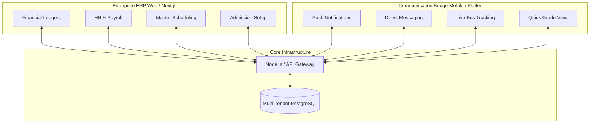

---

## 2. Multi-Tenant Ecosystem

To ensure data privacy and a customized experience, the platform utilizes a single database with isolated schemas per school.

### 2.1 Ecosystem Hierarchy Diagram

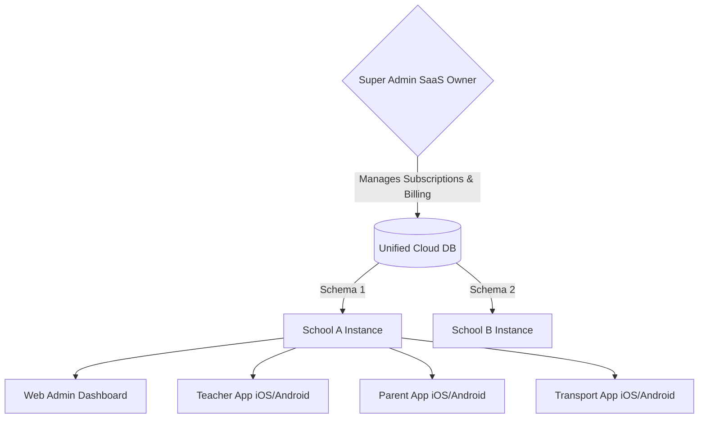

---

## 3. Component Hierarchy

This defines how features are categorized across the different user interfaces within a single school tenant.

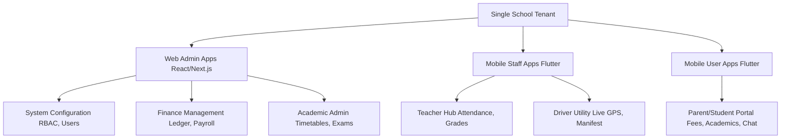

---

## 4. Role-Based Access Control (RBAC)

Administrative staff are strictly siloed based on the principle of least privilege to protect sensitive financial and student data.

| Role | Global Metrics | Financial Data | Student Attendance | Academics & Grades | System Settings |
| --- | --- | --- | --- | --- | --- |
| **Principal / Director** | Full Access | Read-Only | Read-Only | Read-Only | Read-Only |
| **Finance Admin (Bursar)** | Finance Only | Full CRUD | No Access | No Access | No Access |
| **Academic Admin** | Academics Only | No Access | Full CRUD | Full CRUD | No Access |
| **IT / System Admin** | System Health | No Access | No Access | No Access | Full CRUD |

## 4.1 RBAC Permission Matrix

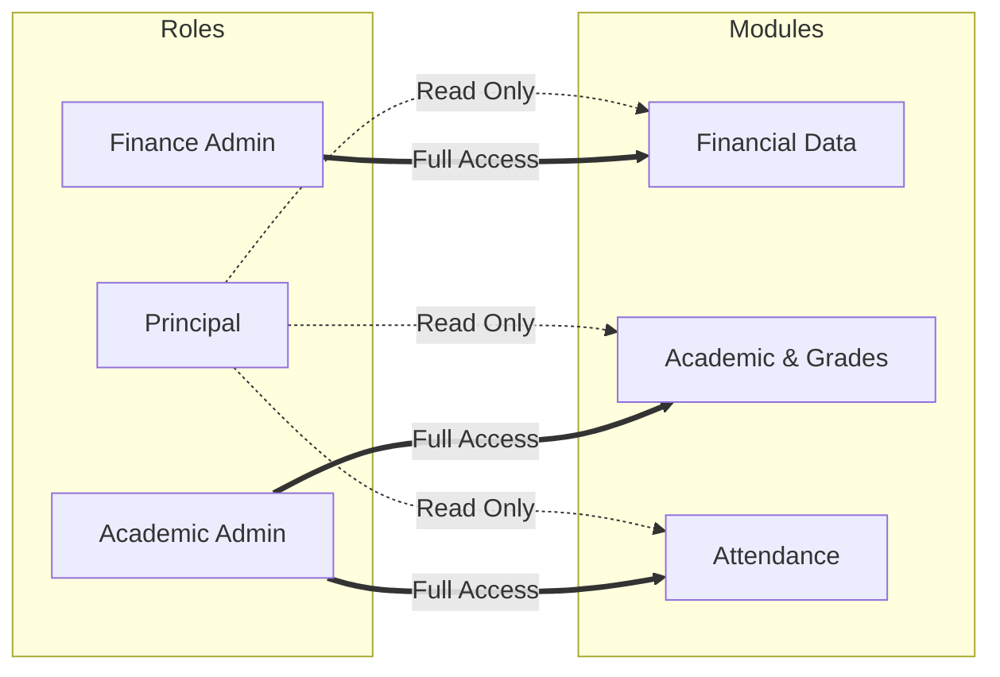

---

## 5. Offline-First Sync Architecture (Crucial for Low Network Zones)

To support users in regions like Jammu & Kashmir with 2G fallback or network blackouts, the Flutter apps rely on local persistence and a background sync queue. Users never see a loading spinner waiting for an API response.

### 5.1 Offline Sync Data Flow

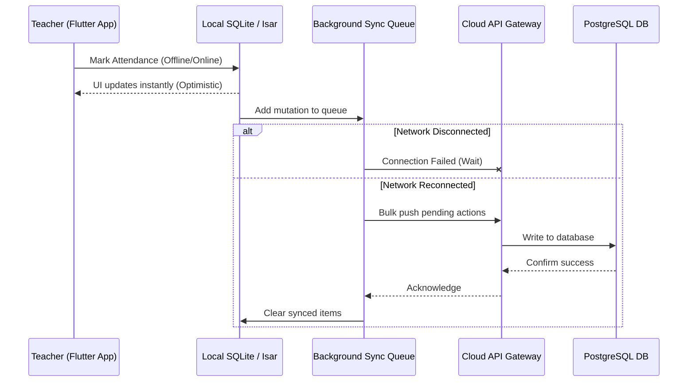

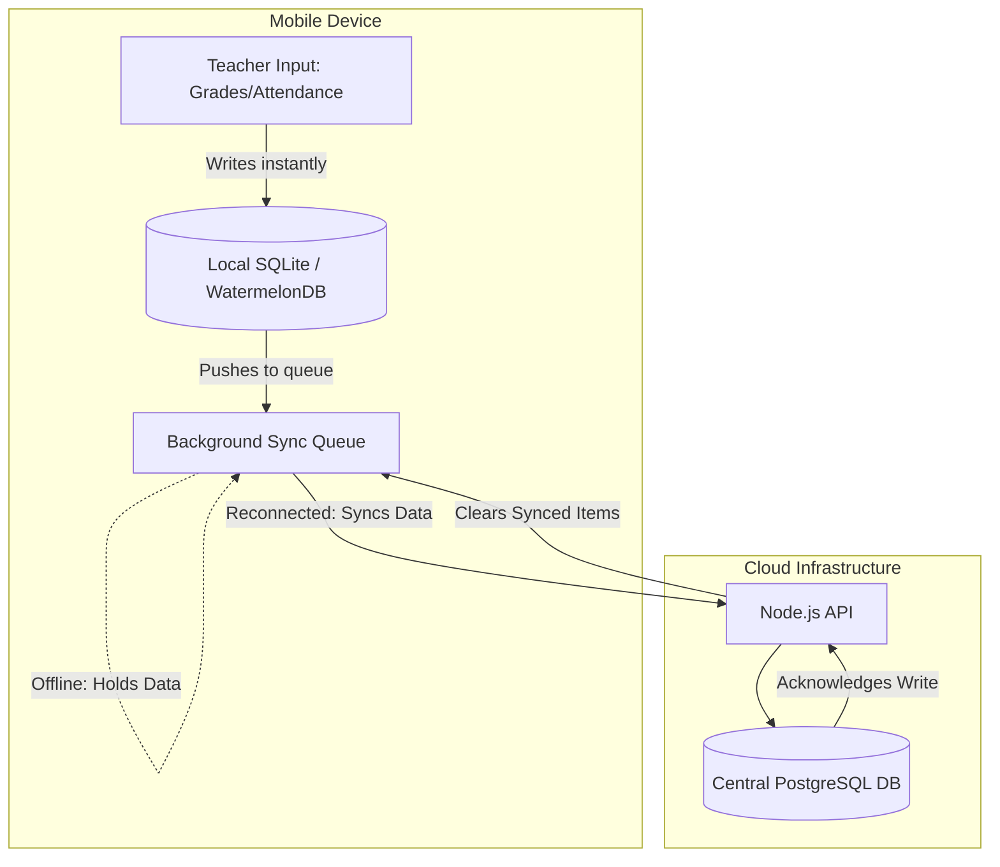

---

## 6. Communication Module

Replacing fragmented WhatsApp groups with a secure, auditable, and professionally bounded messaging system.

- **1:1 Direct Messaging:** Teacher ↔︎ Parent with strict “Office Hours” enforced.
- **Grade-Wide Broadcast:** 1-way announcements from staff to parents (Push Notifications).
- **Community Groups:** Moderated 2-way chat for clubs or PTAs.

### 6.1 Messaging Routing Flow

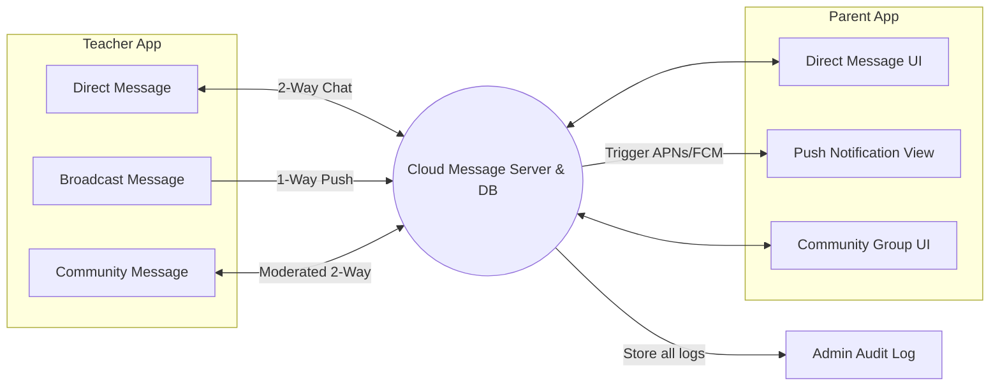

### 6.2 Role-Based Messaging Flow

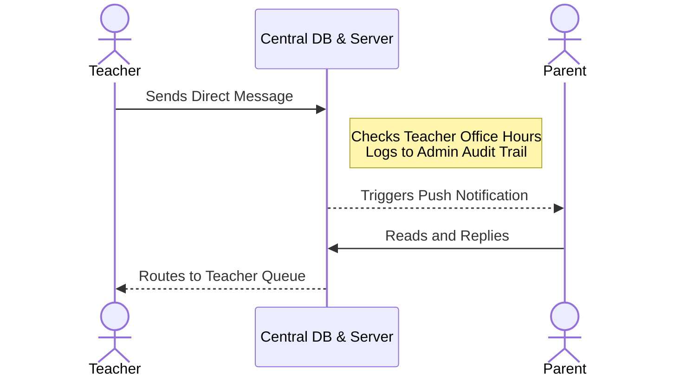

---

## 7. Staff Leave & Substitution Workflow

When a teacher takes leave, it directly impacts the Academic Engine (requires a substitute) and the Finance Engine (payroll deduction).

### 7.1 Automated Substitution & Payroll Flow

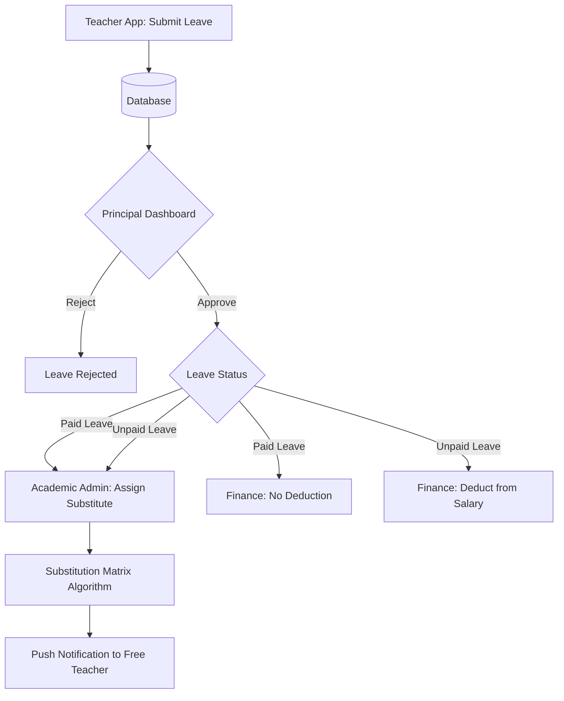

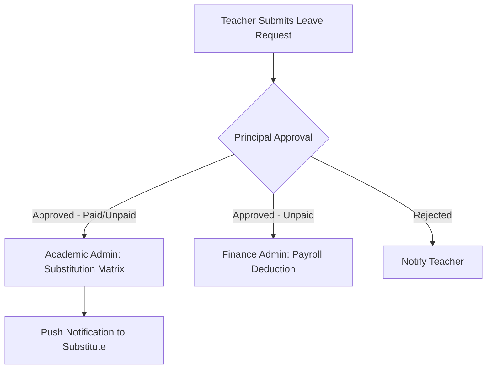

### 8. Two-Pillar Architecture

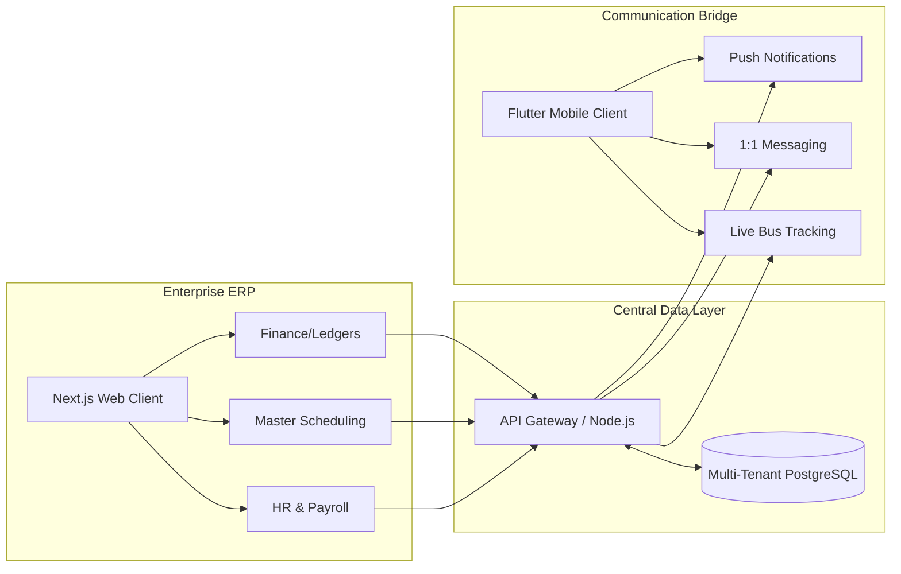

## 9. Tenant System & Component Hierarchy

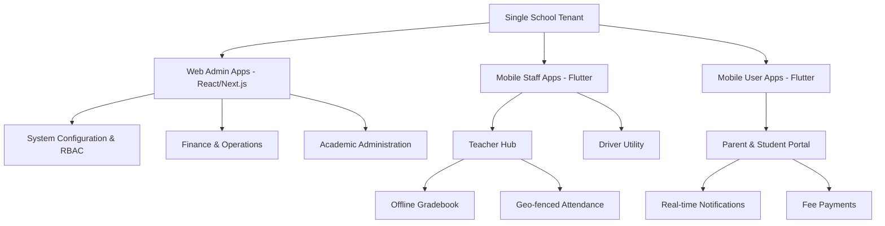

## 10. School SaaS Ecosystem Architecture

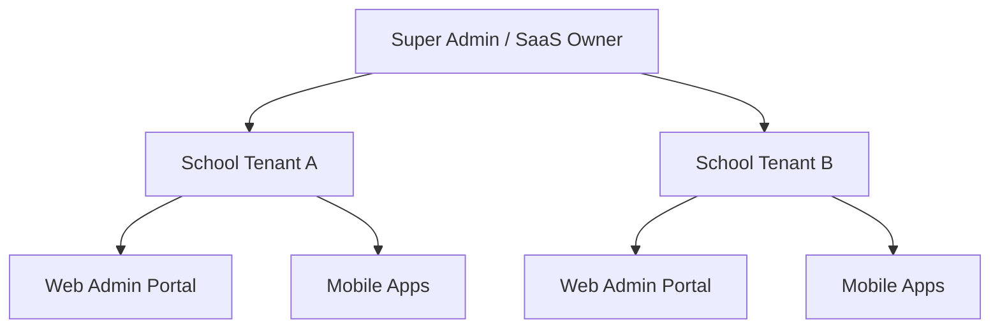

## 11. Project Specifications & Feature Breakdown

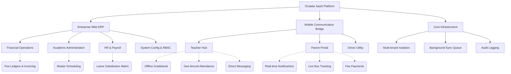

## 12. Technical Stack Architecture

This diagram maps the chosen technologies across the client, API, data, and external service layers. It highlights the offline-first data relationship on mobile and the separation of client applications. When naming nodes, capitalizing reserved words prevents parsing errors in Mermaid.

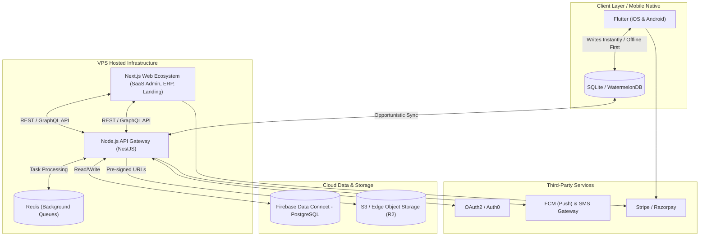
