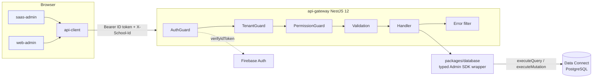

# Phase 1 Implementation Plan: API Gateway & SaaS Foundation

> Status: **proposed, 2026-10-15.** Decisions awaiting owner acceptance are in ADR-0008 and ADR-0009. Task IDs extend `implementation_plan.md` §Phase 1 (P1-1…P1-15); new or changed tasks are marked **NEW**/**CHANGED**. Sizes are relative (S ≤ 2 days, M 3-7 days, L 1-3 weeks, XL longer, one engineer); no dates are promised because team size is not recorded.

**Phase goal (unchanged):** a school can be provisioned, a user can authenticate into exactly one tenant context, and **tenant isolation is proven** by tests on every endpoint.

## 1. Readiness: are we on task to start Phase 1?

**Yes, with one gate to close first.** Evidence (all re-run today, 2026-10-15):

| Phase 0 gate | State | Evidence |
|---|---|---|
| Drift check, 0 errors | ✅ | `npm run check:drift`: 0 errors, 1 intentional warning |
| Known-failing evals now required and green | ✅ | `node --test evals/*.test.mjs`: 42/42, 0 todo |
| RBAC matrix is tested data | ✅ | `packages/rbac`: 46 tests (mutation-checked) |
| Database isolation proven | ✅ | `npm run test:dataconnect`: 63/63 on the emulator |
| Build/lint/typecheck/test | ✅ | Turborepo 32/32; Flutter analyze 5/5; tests 48 + 16 |
| ADRs 0001-0007 accepted | ✅ | |
| **CI green** | ❌ → fixed locally, **unconfirmed** | Both GitHub runs of the Phase 0 commits failed with **no jobs executed**: the workflow YAML was invalid (unquoted colon in a step name, line 28). Fixed; new `workflow-check` drift rule + 5 evals prevent recurrence. Needs one push to confirm green (public API shows run results) |
| Device verification of the font fix | ⏳ running | iOS builds/launch so far pass; Android + integration tests still running |

Nothing technical blocks Phase 1; the CI gate and the owner decisions in §9 come first (workstream M0).

## 2. What Phase 1 delivers



**API surface (all under `/v1`; every route carries `@Permission(...)` or `@Public()` or the gateway will not start):**

| Area | Routes | Who |
|---|---|---|
| Health | `GET /health`, `GET /health/db` | public |
| Public | `GET /public/schools/by-subdomain/:sub` (id, name, branding only; rate-limited) | public |
| Me | `GET /me` (profile, memberships, active school, permissions, navigation from `packages/rbac`), `PATCH /me/preferences` (language) | any signed-in user |
| Platform | `GET/POST /platform/schools`, `GET/PATCH /platform/schools/:id`, `POST …/suspend`, `POST …/activate` | SUPER_ADMIN (`platform_schools`) |
| Tenant | `GET /school`, `PATCH /school` (name, branding, default language) | `settings` |
| Memberships | `GET/POST /memberships`, `PATCH /memberships/:userId` (role/status), `DELETE …` | `memberships` (System Admin only) |
| Invitations | `GET/POST /invitations`, `POST /invitations/:id/revoke`, `POST /invitations/accept` | `memberships`; accept = any signed-in user with a valid token |
| Audit | `GET /audit-log` | `audit_log` (System Admin) |
| Uploads | `POST /uploads/presign` (school logo only in Phase 1) | `settings` |

**Schema additions (additive, each with DB-level tenancy tests):** `SchoolMember.status` (`ACTIVE|SUSPENDED`), `Invitation` table (school, email/phone, role, token hash, expiry, status, created by), `School.defaultLanguage`, `User.language`/`displayName`; operations `GetUser`, `GetMembership`, `ListMembershipsForUser`, `GetSchool`, `GetSchoolBySubDomain`, `ListSchools`, `UpdateSchool`, `SetSubscriptionStatus`, `UpdateMembership`, invitation ops, `ListAuditLog`. Platform-level operations are the only ones without `$schoolId` and are listed in `tenantScopeExemptOperations`. Every state-changing mutation includes `auditLog_insert` in its `@transaction`.

## 3. Verified facts the plan stands on (and how they were checked)

| # | Fact | Evidence |
|---|---|---|
| F1 | `firebase-admin@13.10.0` exposes `getDataConnect({location, serviceId, connector})` with named `executeQuery(name, vars)` / `executeMutation(name, vars)` and raw `executeGraphql`; named calls need `connector` set | read `node_modules/firebase-admin/lib/data-connect/data-connect.d.ts` and `…internal.js` in a scratch install |
| F2 | Without impersonation, those calls "run with admin privileges and ignore all auth directives" ⇒ `NO_ACCESS` operations are callable by the gateway | JSDoc in the same `.d.ts` (still to be **proven at runtime**: P1-2b acceptance) |
| F3 | Admin SDK emulator env vars: `DATA_CONNECT_EMULATOR_HOST` (host:port, no scheme) and `FIREBASE_AUTH_EMULATOR_HOST`; `verifyIdToken(idToken, checkRevoked?)` | `…internal.js:449`, `auth/auth-api-request.js:1940`, `auth/base-auth.d.ts:129` |
| F4 | The CLI can generate a typed **Admin** Node SDK: `generate.adminNodeSdk` in `connector.yaml`; output has `createInvoice(dc, vars)`-style functions, enums, `Int64String`; peer `firebase-admin ^13.4 \|\| ^14` | `firebase-tools@15.34.0` `schema/connector-yaml.json`; generated for real in a scratch copy of our connector |
| F5 | Nest-12-compatible add-ons exist: `@nestjs/swagger@12.0.2`, `@nestjs/config@12.0.1`, `@nestjs/throttler@6.7.1`, `@nestjs/terminus@12.1.0`, `nestjs-pino@5.3.1` (+`pino@10`) | `npm view … peerDependencies engines` |
| F6 | **Not** compatible: `nestjs-zod@5.5.0` (peers `@nestjs/common ^10 \|\| ^11`); `openapi-typescript@7.13` (peer `typescript ^5.x`, repo uses 6) | same |
| F7 | Client generator that fits TypeScript 6: `@hey-api/openapi-ts@0.99` (peer `>=5.5.3 \|\| >=6`), needs Node `>=22.18` | same |
| F8 | Node floor 22: `@angular-devkit/core@22.1.8` `^22.22.3`; `nestjs-pino` `>=22.12`; `jsdom@30` `^22.22.2`; Nest core itself only `>=20` | `node_modules/*/package.json`, registry |
| F9 | The Auth emulator is built in (not a Java binary); only emulators whose command binary is `java` need Java; Data Connect uses its own binary | `firebase-tools/lib/emulator/downloadableEmulators.js:321` and `Commands` table |
| F10 | Decorator metadata/constructor DI works under this repo's Vitest 4.1.11 / Vite 8.3 (`AppController(private appService)` passes its unit and e2e tests) | `apps/api-gateway/src/app.controller.ts:6` + passing runs |
| F11 | Next 16 + Cache Components: session reads are request-time and must be behind `<Suspense>`; Proxy only for optimistic cookie checks; `use cache: private` for per-user cached data | `next/dist/docs/01-app/02-guides/authentication-with-cache-components.md`, `authentication.md` ("Optimistic checks with Proxy") |
| F12 | All 38 design icons map to real Lucide exports in `lucide-react@1.57.0` (e.g. `home→House`, `alert→TriangleAlert`, `check-circle→CircleCheck`, `tasks→ListChecks`) | node script over the installed package: 38 mapped, 0 missing |
| F13 | React 19-compatible test libs: `@testing-library/react@16.3.3` (peers React 18/19), `happy-dom@21` (Node ≥20), `jsdom@30` (Node ≥22.22); Storybook `@storybook/nextjs@10.6` lists Next 16 | `npm view` |

**Not verified (do not assume; each has a spike):** that `NO_ACCESS` operations execute through the Admin SDK against the emulator (P1-2b); Next `output: 'standalone'` in this monorepo, Docker layout, Nginx wildcard TLS (P1-12 spike); `@aws-sdk` presigner for R2 (P1-13 spike); the data-residency question in §9 (Q8).

## 4. Workstreams and tasks

### M0: Phase 0 closeout (do first; mostly owner actions)
| ID | Task | Size | Acceptance |
|---|---|---|---|
| **P1-0a** NEW | Commit the post-Phase-0 work (font fix, integration tests, workflow fix, validator) and push; confirm CI green | S | GitHub run `success` for all three jobs (read via the public API); any runtime failure fixed (known unknowns: Flutter job on Linux, emulator job) |
| **P1-0b** DONE (`.nvmrc`, engines, drift rule `node-version`; owner still runs `nvm install 22`) | Node 22 floor: `.nvmrc`=22, root `engines.node >=22.22.3`, CI already 22, README; drift rule that CI `node-version` equals `.nvmrc` major; owner runs `nvm install 22` | S | `node -v` ≥ 22.22.3 locally; `npm ci` has no EBADENGINE warnings |
| **P1-0c** PARTLY DONE (audit updated with what was observed; Android, the other iOS apps and the Driver relaunch still need the owner's devices) | Record the device verification (fonts fix, Driver relaunch) in the audit; add the findings not yet logged (home-screen label truncation is an owner naming decision) | S | audit updated |
| **P1-0d** NEW | Owner decisions Q1-Q9 (§9); accept ADR-0008/0009 | S | ADRs marked Accepted |

### M1: Gateway skeleton and data access
| ID | Task | Size | Depends | Acceptance / tests |
|---|---|---|---|---|
| **P1-1** DONE (branch app/api-gateway; 14 unit + 8 e2e, mutation-checked) | Config (class-validator env schema, fail-fast, never prints values), `/v1` prefix, helmet, CORS from `CORS_ORIGINS`, pino logging with request id, `GET /health`, throttler wiring; Vitest unit + supertest e2e conventions | M | P1-0b | app refuses to boot with a bad env (test); request id echoed in header and logs; health 200 |
| **P1-2a** DONE | Switch generation to `adminNodeSdk` (output into `packages/database`), remove the client SDK + `@oruschools/erp-sdk` from the gateway, update the CI "SDK current" step path | S | P1-1 | `dataconnect:compile` regenerates identical committed code; gateway builds without the client SDK |
| **P1-2b** DONE (runtime proof: `npm run test:database`, 6 emulator tests + 12 unit, mutation-checked; gateway wiring of `DatabaseModule` follows on `app/api-gateway`) | `packages/database`: `DatabaseModule` wrapping `getDataConnect({location:'us-east4', serviceId:'oruschools', connector:'erp-connector'})`, typed operation facade, error mapping (`ABORTED`→403, `INVALID_ARGUMENT`→400, transport→502), emulator via `DATA_CONNECT_EMULATOR_HOST` | M | P1-2a | **runtime proof**: `CreateSchool` (a `NO_ACCESS` op) succeeds through the Admin SDK on the emulator; the Phase 0 cross-tenant aborts surface as the mapped error; unit tests with a fake `DataConnect` |
| **P1-2c** DONE (tests are typed Vitest integration tests in `packages/database/test/phase1-ops.integration.ts`, 19 emulator tests, rather than additions to the shell script; mutation-checked by removing an audit insert and a `@check`; drift rule `dc-audit`, evals E-DC-AUD-1..6) | Schema + operations additions (§2), DB-enforced scoping, audit inside transactions; extend `tools/tests/dataconnect-tenancy.sh` | L | P1-2b | new checks pass; mutation test (remove an `@check`/audit insert → fails); drift rule `dc-audit` (every Phase 1 mutation has `auditLog_insert`) with a negative test |

### M2: Identity, tenancy, authorisation, audit (the security core)
| ID | Task | Size | Depends | Acceptance / tests |
|---|---|---|---|---|
| **P1-3a** DONE (branch app/api-gateway; 49 unit + 18 e2e + 5 real Auth-emulator tests, 5 mutants killed; emulator run via `npm run test:gateway`) | `AuthGuard`: parse Bearer, `verifyIdToken`, `AuthenticatedUser`; `@Public()` opt-out; 401 envelope | M | P1-2b | spike proves behaviour against Auth-emulator tokens; expired/garbage/missing token → 401 `AUTH_REQUIRED` |
| **P1-3b** DONE (branch app/api-gateway; 62 unit + 37 e2e, 8 mutants killed; AsyncLocalStorage spike resolved: the context rides on the request object and is passed explicitly, proven isolated under 60 interleaved concurrent requests) | `TenantGuard`: `X-School-Id` UUID → ACTIVE `SchoolMember` of a non-suspended school (membership cached ≤30 s, invalidated on role change); uniform 403 so a school's existence is not revealed; spike AsyncLocalStorage vs request scope | L | P1-3a, P1-2c | non-member/suspended/unknown id → identical 403; `schoolId` in body/query never read (test) |
| **P1-3c** DONE (branch app/api-gateway; 75 unit + 63 e2e + 5 emulator tests; 8 mutants killed) | `PermissionGuard` + `@Permission(resource, action)` mapped to `packages/rbac` `authorize()`; global deny-by-default; **startup fails** for a route without a decision | M | P1-3b | route-enumeration test fails if any route lacks `@Permission`/`@Public`; SUPER_ADMIN reaches only `/platform/*` |
| **P1-3d** DONE (branch app/api-gateway; 91 unit + 69 e2e, 9 mutants killed) | Record-level rules the matrix cannot express: a Principal may not approve their own leave; HR `leave:update` may not change `status` (Phase 3 uses them; the guard hooks and tests land now) | S | P1-3c | unit tests for both rules |
| **P1-4** DONE (branch app/api-gateway; 141 unit + 80 e2e, 9 mutants killed; E-AUD-1 static half enforced at startup and over the route table, the runtime half "every mutating route adds an audit row" belongs to the P1-7 harness) | Audit: transactional audit rows (P1-2c) + `AuditInterceptor` for security events (401/403, role-change attempts) and request metadata (actor, school, route, requestId, outcome; no payloads/secrets) | M | P1-3c | E-AUD-1: every mutating route's operation writes an audit row (test through the harness) |
| **P1-5** DONE (branch app/api-gateway; 160 unit + 108 e2e + 5 emulator tests, 11 mutants killed; `openapi.json` checked by `npm test`) | Validation pipe (whitelist, forbid unknown), error envelope + closed machine-code registry, throttler (per IP, per user), OpenAPI via `@nestjs/swagger` (bearer scheme, `X-School-Id`, envelope, stable operationIds), committed `openapi.json` + drift check | M | P1-3c | envelope shape tests; OpenAPI regenerated in CI equals committed; body `schoolId` rejected |
| **P1-7** DONE (branch app/api-gateway; 151 real-emulator tests via `npm run test:gateway`; the generator is proven on probe routes of every access class because no tenant/platform route exists yet; 7 mutants run, 5 killed, 2 equivalent) | **Cross-tenant harness**: Vitest globalSetup starting Data Connect + Auth emulators once; fixtures = 2 schools × 14 roles + SUPER_ADMIN + a parent linked to a student, created through the real operations; tokens minted via the Auth emulator; **route matrix generated from the registered routes** asserting unauthenticated 401, wrong tenant 403, wrong role 403, body `schoolId` ignored, for every route; a new route missing from the matrix fails the build | L | P1-5 | E-TEN-API-* and E-RBAC-API-* green; mutation test: remove a guard from one route → the matrix fails |

### M3: Modules
| ID | Task | Size | Depends |
|---|---|---|---|
| P1-6a DONE (branch app/api-gateway; `/v1/me` + `PATCH /v1/me/preferences`; 177 unit + 120 e2e + 9 real-emulator tests) | `GET /me` (+ `PATCH /me/preferences`): profile, memberships, active school, permissions, navigation via `navigationFor` | M | P1-3c |
| P1-6b DONE (branch app/api-gateway, stacked on /me; 220 unit + 120 e2e + 218 real-emulator tests; 6 mutants killed) | Platform schools: list/create/get/update, suspend/activate (suspended school ⇒ every tenant route 403 `SCHOOL_SUSPENDED`), audit | L | P1-7 |
| P1-6c DONE (branch app/api-gateway, stacked; 236 unit + 120 e2e + 343 real-emulator tests; 4 mutants killed) | Memberships: list, add existing user, change role/status, remove; **only `memberships` holders**; protected rules (cannot remove the last Principal or System Admin) | L | P1-6b |
| P1-6d DONE (branch app/api-gateway; 282 unit + 121 e2e + 448 real-emulator tests; 6 mutants killed) | Invitations: create (email/phone + role + expiry), list, revoke, accept (single-use, token hashed, expiry, rate limited); Phase 1 delivers the link by copy (no email/SMS provider yet) | L | P1-6c |
| P1-6e DONE (branch app/api-gateway; 331 unit + 121 e2e + 499 real-emulator tests; 6 mutants killed) | `GET /public/schools/by-subdomain/:sub` (minimal fields, throttled) | S | P1-6b |
| P1-13 BUILT (cross/phase1-finish; 570 real-stack tests; 5 of 6 mutants killed, 1 equivalent; no real upload to R2 yet) | R2 presigned upload (school logo; tenant-prefixed key, content-type + size limits) | S | P1-6a (spike first) |
| P1-14 BUILT (cross/phase1-finish; web-admin 50 + saas-admin 33 tests; 7 mutants, 1 equivalent) | Language preference: user + school default; gateway returns it; picker links `/ur/...` | M | P1-6a |

### M4: Contract and client
| ID | Task | Size | Depends | Acceptance |
|---|---|---|---|---|
| P1-8 DONE (`cross/api-client`; 39 client unit tests + 8 real-stack tests; 8 mutants killed) | `packages/api-client` generated with `@hey-api/openapi-ts`: async token provider, `X-School-Id` injection, typed `ApiError` (machine code), BigInt-safe `Int64String`, abort/timeout | M | P1-5 (skeleton spec) | contract test: client types compile against the committed spec; error mapping tests |

### M5: Frontends (starts after the P1-5 spec skeleton exists; runs parallel to M3)
| ID | Task | Size | Depends |
|---|---|---|---|
| P1-11 CHANGED (B1 built: 7 components; B2 built: Banner, EmptyState, StatusPill, SyncStatus; B3 built: Card, StatCard, ListRow, ActionTile, LinkAction; B4 built: SideNav, BottomNav, Logo; 104 tests; web-app wiring and the catalogue route remain incl. axe + RTL) | `packages/shared-ui` in four batches: **B1** Icon, Button, Badge, Avatar, Checkbox, TextField, SegmentedControl; **B2** Banner, EmptyState, StatusPill, SyncStatus; **B3** Card, StatCard, ListRow, ActionTile; **B4** SideNav, BottomNav, Logo. Tests: Vitest + Testing Library + jsdom (Node 22), `axe-core` assertions, RTL (`dir=rtl`) and density variants; dev-only catalogue route in web-admin (Storybook is heavier and deferred) | XL | P1-0b |
| P1-9 BUILT (branch cross/saas-admin-login; 47 app tests, 8 mutants killed; not yet run against the real gateway with a real sign-in) | `saas-admin`: Firebase web SDK login, client route protection, school list/create/edit/suspend, language switcher, **bootstrap script** `tools/bootstrap-super-admin.mjs` (Admin SDK, sets the claim + `User` row; never an HTTP endpoint) | L | P1-8, P1-6b, P1-11 B1-B2 |
| P1-10 BUILT (cross/web-admin-shell; web-admin 40 tests, web-auth 35, gateway CORS 350+123; 9 of 9 mutants killed after one added test; not yet tried in a browser against the live gateway) | `web-admin` shell: login, school from subdomain (public endpoint), `GET /me` → `SideNav`, page layout (greeting + ≤5 `StatCard`s), `EmptyState`, error boundary for envelope codes | L | P1-9, P1-11 B3-B4, P1-6a |

### M6: Infrastructure and process
| ID | Task | Size | Notes |
|---|---|---|---|
| P1-12 | Staging: Dockerfiles (gateway, web), Nginx wildcard subdomains, deploy workflow, health checks, env/secret handling (secrets only in the gateway) | L | **Spike first** (Next standalone in this monorepo, `turbo prune`, wildcard TLS): none of this is verified yet. Start after M2 so staging finds integration problems early |
| P1-15 BUILT (review page + tools/translations.mjs; glossary of 123 terms, evals E-TR-1..7 and E-GL-1..7; reviewers not chosen yet, so no language is marked reviewed) | Translation workflow (export/import, glossary) | M | owner-driven; needs the Hindi/Urdu reviewers |
| **P1-16** DONE (CI already ran the emulator gateway suite, SDK freshness and the OpenAPI check; emulators are now cached between runs) | CI: emulator-backed gateway job (cached emulators), OpenAPI drift step, `actionlint`-style workflow validation (done: `workflow-check`) | S | with P1-7 |

## 5. Order and parallelism

```
M0 ─► M1 (P1-1 → P1-2a → P1-2b ─► P1-2c) ─► M2 (P1-3a → P1-3b → P1-3c → P1-4/P1-5 ─► P1-7) ─► M3 ─┐
                                                      └─(OpenAPI skeleton)─► P1-8 ─► M5 ──────────────┴► Gate
P1-11 (shared-ui B1..B4) can start right after P1-0b and runs alongside M1-M3. P1-12 spike starts after M2.
```
**Critical path:** P1-2b → P1-2c → P1-3a → P1-3b → P1-3c → P1-7 → P1-6b/6c/6d. Two tracks can work in parallel after M0: *gateway* (M1-M3) and *UI* (P1-11, then P1-8/9/10).

## 6. Evals and gates (the phase closes only when all pass)
- **E-TEN-API:** for every route, unauthenticated 401; user of school A on school B's id 403; body/query `schoolId` ignored; list endpoints never include B rows.
- **E-RBAC-API:** the matrix above against the 14 roles; SUPER_ADMIN has no tenant routes; only `memberships` holders touch memberships; Principal self-approval and HR status rules.
- **E-AUD-1:** every mutating route writes an audit row atomically with the change.
- **E-SUSP:** a suspended school is denied on every tenant route.
- **E-DB-ADMIN:** a `NO_ACCESS` operation runs through the Admin SDK on the emulator (closes the Phase 0 "not verified").
- **E-API-CONTRACT:** committed `openapi.json` equals the generated one; `api-client` compiles against it.
- **E-CI:** all CI jobs green on GitHub.
- **E-UI:** the 18 components pass unit + axe + RTL tests; `check:drift` clean (no physical left/right, no raw colours, no hard-coded strings).
- Plus the existing gate items: staging reachable, drift clean, docs and `CLAUDE.md` "Current reality" updated.

## 7. Risks and mitigations
| Risk | Mitigation |
|---|---|
| Admin SDK behaves differently on the emulator than documented | P1-2b is the first spike and a hard acceptance criterion; fall back to `executeGraphql` with the compiled operation text |
| Tenant-context design (ALS vs request scope) leaks state across requests | spike in P1-3b with a concurrency test (parallel requests for two schools never see each other's context) |
| A new route ships without protection | startup fails without `@Permission`/`@Public`; route-matrix test; both mutation-tested |
| Audit forgotten on a new mutation | drift rule `dc-audit` makes it a build failure |
| Node 22 requirement surprises contributors | `.nvmrc`, `engines`, README, CI all pin it (P1-0b) |
| `@hey-api/openapi-ts` is pre-1.0 (0.99) | pin the exact version; contract tests; the generated client is committed so upgrades are reviewed diffs |
| Staging work (unverified) finds late surprises | spike right after M2, not at the end |
| Client-side tokens (ADR-0009) are XSS-sensitive | strict CSP, no inline script, short-lived tokens, documented upgrade path to session cookies |
| Region `us-east4` for Indian schools: latency and minors' data residency | owner question Q8; decide before provisioning Cloud SQL |

## 8. Explicitly out of scope for Phase 1
Email/SMS delivery of invitations (copy-link only), phone-OTP login, parent/driver sign-up, the sync endpoints (Phase 3), payments, Storybook, session cookies, multi-instance cache invalidation, backups/DR (Phase 6), any school feature (Phases 2-5).

## 9. Owner questions (answers needed before or during M0)
1. **Accept ADR-0008** (Node 22 floor, admin SDK in `packages/database`, class-validator stack, error envelope, transactional audit)?
2. **Accept ADR-0009** (Bearer tokens from the browser in Phase 1; session cookies later if needed)?
3. Which **sign-in methods** for Phase 1 staff accounts: email + password only? (phone OTP for parents/drivers arrives with their apps)
4. **Invitations delivered by copy-link** in Phase 1 is acceptable until an email/SMS provider is chosen?
5. **Who is the first SUPER_ADMIN** (email) for the bootstrap script, and which Firebase project is it (`.firebaserc` is empty today)?
6. **Staging**: which VPS/provider and domain (wildcard `*.domain` needed for school subdomains)?
7. **Audit atomicity**: transactional audit inside each mutation (recommended) vs a separate write by the gateway (simpler but can lose an audit row)?
8. **Region**: Data Connect is configured for `us-east4`; for schools in India, do you want an India-region database (latency, data residency for minors' records) before Cloud SQL is provisioned?
9. The new RBAC grants listed in `packages/rbac/README.md` still await confirmation, and the iOS home-screen label ("OruSchools Teacher" truncates) needs a naming decision.

### Owner answers (2026-10-17)
| # | Question | Answer | Consequence |
|---|---|---|---|
| 1, 2 | Accept ADR-0008 / ADR-0009 | Accepted (earlier) | - |
| 3 | Sign-in methods | **Email + password, Google, and phone one-time code** | Email and Google users have a verified email, so they can accept invitations. A phone-only user has no email: `User.email` gets a reserved `<uid>@no-email.invalid` placeholder and they **cannot accept an email invitation** (`EMAIL_NOT_VERIFIED`). Parents and drivers who only have a phone need invitation-by-phone (the number is stored on the invitation but unused today) before their apps (Phase 5). Firebase phone sign-in needs the paid plan and costs per SMS, plus app-attestation setup on mobile (not verified here; check Firebase pricing and docs when enabling). The web apps must send the verification email after password sign-up. |
| 4 | Invitations by copy-link | Accepted in practice (built that way); email/SMS delivery is a later decision | - |
| 5 | First SUPER_ADMIN | **The project owner.** `tools/bootstrap-super-admin.mjs` is written and tested end to end on the emulators | Needs the owner's sign-in email and the real Firebase project id (`.firebaserc` is still empty) and a service-account key kept on the owner's machine. Dry run by default; `--apply` does it; `--revoke` removes it. |
| 6 | Staging host and domain | **Skip staging for now** | P1-12 (Dockerfiles, Nginx, deploy) is deferred; the Phase 1 gate item "staging reachable" is waived by the owner for now. CI and the emulator-backed harness remain the integration environment. |
| 8 | Region | **Mumbai, `asia-south1`** | `dataconnect/dataconnect.yaml` and the generated SDK are switched. `asia-south1` is in the Data Connect location list shipped with firebase-tools; availability and pricing are not verified until the service is created. |
| 9 | New RBAC grants, iOS label | Still open | - |

### Update 2026-10-17: staff and driver accounts (ADR-0011)
Owner decision: staff and drivers get accounts created by the System Admin (phone-only: one-time code; email: a set-password link, chosen over an emailed generated password). Built as `POST /v1/memberships/accounts`: 310 unit + 121 e2e + 486 real-emulator tests, 6 mutants killed. Follow-ups: the web clients send the Firebase set-password email (P1-9/10); invitation by phone before the parent app.

