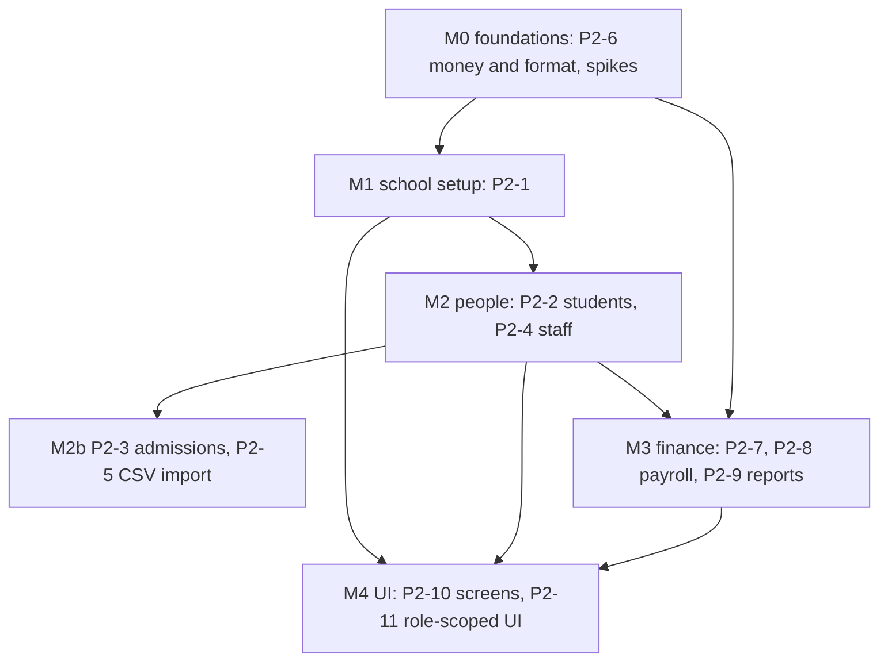

# Phase 2 Plan: School ERP Core & Finance

> Status: **proposed, 2026-10-22.** Product decisions are in ADR-0012. Task IDs follow `implementation_plan.md` §Phase 2; new or changed tasks are marked **NEW** / **CHANGED**. Update statuses here as work lands.

**Phase goal (unchanged):** a school can be configured, populated and billed.

## 1. Starting point (verified 2026-10-22, not assumed)
| Fact | Evidence |
|---|---|
| Phase 1 gate met except P1-15 (reviewers) and the waived staging deploy | `phase1_plan.md`; 570 real-emulator gateway tests; CI green on `staging` |
| Tenant tables exist but are thin | `schema.gql`: `Student` (name, enrolment id, grade level), `ParentGuardian`, `AcademicYear`, `Classroom`, `Subject`, `Invoice` (amount, due date, status), `Payroll` (amount, pay date, status) |
| Everything needed for Phase 2 tables is **missing** | no grade/section, department, staff profile, application, fee structure/item/instalment, concession, payment, receipt, salary structure, payroll run/line, ledger entry, document |
| The platform to build on works end to end | gateway guards, audit-in-transaction, typed client, shared UI (18 components), web-admin shell with `/me` navigation, owner/school/first-admin flows, R2 upload addresses |
| Roles and resources are already modelled | `packages/rbac` matrix covers `students`, `academics`, `admissions`, `staff`, `finance`, `payroll`, `settings`, `reports_*`, `dashboard_*`; navigation items for each exist |
| Money helpers exist but not formatting | `packages/api-client/src/money.ts`: Int64 string parsing and basic `formatMinor`; no rounding rules, no per-school formatting, no Dart side |

## 2. How each module is built (the same shape every time)
1. **Data Connect operations**: every one takes `$schoolId`, filters by it, `@auth(level: NO_ACCESS)`; every mutation writes its audit row in its own `@transaction`; a unique key wherever a duplicate would be a bug.
2. **Gateway module**: DTO classes (whitelist, no body `schoolId`), `@Permission(resource, action)`, `@Audit` or `@NoAudit`, pagination limits, the closed error list.
3. **Tests**: unit; real-emulator (the cross-tenant and role matrix covers new routes automatically; add the audit sample and the module's own rules); a mutation check on each rule.
4. **Contract**: `openapi.json` and the typed client regenerate; the contract test knows any new route class.
5. **UI** (P2-10) uses the shared components, the shell's navigation, words from `packages/i18n` (+ glossary terms), right-to-left checked.

## 3. Workstreams

### M0 Foundations
| ID | Task | Size | Acceptance |
|---|---|---|---|
| P2-6 BUILT (`packages/format` + Dart twin `OruFormat` in flutter-core; 133 TypeScript tests and the same vectors in Dart, expected values from an independent Python implementation; 11 of 11 mutants killed) | **Money and format library** (TypeScript + Dart from one set of test vectors): integer minor units, rounding (half-up to the minor unit, never `Number`), currency and locale from the school, Indian grouping (`₹1,82,40,000`), dates (`Tue, 24 Jun`), times (`8:45 AM`), in all 19 languages' number formats where the platform supports them | S | `packages/format/vectors.json` is run by both the TypeScript tests and the Dart tests with identical results; mutation-checked |
| P2-0a DONE (mechanism works; real concurrency NOT proven, see `phase2_spikes.md`) | **Spike: receipt numbers and invoice uniqueness** under concurrent writes (counter row in a transaction, unique keys, retry) on the emulator | S | 100 parallel payments give unique, gap-free numbers per school and year; duplicate invoice generation creates nothing |
| P2-0b DONE (PDFKit rejected, skia-canvas chosen) | **Spike: PDF with Hindi and Urdu text** (candidate: PDFKit with fontkit; the bundled Noto fonts) | S | a receipt PDF with Devanagari and Nastaliq text renders with correct shaping (inspected); otherwise the decision in ADR-0012 applies |
| P2-0c DONE (exact Int64 sums and paging work) | **Spike: Data Connect aggregates and pagination** (sum of `*Minor` as Int64, counts, filtered lists with limit and offset, N+1 behaviour) | S | numbers equal an independent sum; list of 5,000 rows pages correctly |

### M1 School setup
| ID | Task | Size |
|---|---|---|
| P2-1 BUILT (backend; gateway `/v1/school/profile|logo` and `/v1/academics/{levels,classes,subjects,years}`, 20 DB-level tests and an end-to-end suite on the real emulators, audit samples for all 15 write routes; the colour-derivation preview and the screens are P2-10) | School configuration: **grade levels** (seeded Nursery, LKG, UKG, 1 to 12; editable), **sections**, classrooms, subjects, **academic years (exactly one active)**, school profile and **branding Mode A** (logo through the R2 upload address, one primary colour checked at 4.5:1 with white text, derived hover/text/soft/focus preview before save), locale default `en-IN` | M |

### M2 People
| ID | Task | Size |
|---|---|---|
| P2-2 BUILT (backend) (students, enrolment ids, class placement per year and guardian contacts: `/v1/students`; 51 database tests and an end-to-end suite on the real emulators; photo and up to 30 documents per student in a PRIVATE bucket: signed upload address locked to type and size, attach checks the object and the student's own path, signed read addresses of five minutes; NOT yet: inviting a guardian to an account (arrives with admissions, P2-3), own/linked scopes for teachers and parents (they get an empty list)) | Students: create, edit, list with search, filters and pagination, enrolment ids (school prefix plus a race-free sequence), class placement per academic year, guardians through `ParentGuardian` (a guardian is invited, never auto-created with a password), photo and documents in a **private** bucket | L |
| P2-4 BUILT (backend; `/v1/staff`: records with generated employee numbers, department and designation, optional link to a sign-in account that must already be a member of the school (never grants a role), photo and up to 30 documents in the private bucket; 7 database tests and an end-to-end suite; onboarding a new sign-in account stays with the System Admin's `/v1/memberships/accounts`) | Staff: profile, department, role through memberships (only a System Admin grants roles), onboarding through the existing account flow, documents (private bucket) | L |
| P2-3 BUILT (backend; `/v1/admissions`: application with a generated number, review steps SUBMITTED to UNDER_REVIEW to ACCEPTED or REJECTED or WITHDRAWN, edits only while open, admit = student + class placement + guardian contact + new status in ONE transaction; 8 database tests and an end-to-end suite). **Two deliberate differences from the task text, to confirm:** (1) admitting does NOT send a guardian invitation: ADR-0007 reserves granting roles to the System Admin, so the result says `guardianInvitationPending` and the System Admin invites the guardian through `/v1/invitations`; (2) the review steps need the matrix's `admissions:update` grant (Admissions Officer, Academic Admin); the Principal holds only `admissions:read` in the matrix, so the Principal cannot accept or reject until the matrix is changed (an ADR-0007 decision for the owner) | Admissions: application, review, admit (Principal or Admissions Officer rules from the matrix), admitting creates the student and sends guardian invitations; every step audited | M |
| P2-5 BUILT (backend; `/v1/imports/{students,staff,guardians}` with `/dry-run`: a dry run reads and checks only and writes nothing, not even an audit row; it reports every problem by spreadsheet row and column with a machine-readable rule; the real import refuses a file with any problem, cannot run twice for the same file (SHA-256 per school and kind), then creates the rows one by one through the ordinary operations, each audited with the batch id, between an `import.start` and an `import.finish` record; up to 500 rows per file, dates day-first (31/03/2015) or ISO, 10-digit mobiles become +91. **Differs from the task text:** Data Connect cannot take a list of rows in one transaction, so the import is NOT all-or-nothing at the database level: validation is all-or-nothing, and if a row then fails the run ends PARTIAL and says which rows were not created; the same file is then blocked, so fix and upload only the missing rows) | CSV import (students, staff, guardians): a **dry run that never writes** reports every problem by row and column; the real import is one audited batch | M |

### M3 Finance (needs M0 spikes)
| ID | Task | Size |
|---|---|---|
| P2-7a BUILT (backend; `/v1/fees`: one fee structure per class level and academic year, fees (items) each with 1 to 24 instalments created all or nothing, concessions per student (percent in basis points or a fixed amount, on every fee or one fee), and `GET /v1/fees/students/:id/schedule` that lists what a student owes with the concessions applied; money is integer paise sent as strings; discount arithmetic is bigint, half away from zero, never below zero, and is the same code invoice generation will use; 10 unit tests, 8 database tests, an end-to-end suite) | Fee structures (per class level and academic year), fee items with instalments, concessions | M |
| P2-7b BUILT (backend; `/v1/fees/invoices`: generation per student per fee instalment up to a due date, for a student, class, level or the whole year, with a dry-run preview; one invoice per student per instalment is a DATABASE key, so generating twice creates nothing; concessions are applied with the P2-7a arithmetic; payments by cash, cheque, bank transfer, UPI or other with a reference, partial payments, an overpayment is refused and two cashiers paying at once can never overpay (the database refuses a payment that started from a stale paid total); a payment is never edited or deleted, a mistake is REVERSED (kept, marked, taken out of the invoice; Bursar only); `GET /fees/outstanding` ages unpaid money into five bands with exact database sums; student statements; manual invoices. **Not in this task:** the numbered receipt and the PDF are P2-7c; receipt-number allocation under real Cloud SQL concurrency is still to be proven then) | Invoice generation per student per instalment, **idempotent**; manual payment recording (cash, cheque, bank transfer, UPI reference), partial payments; outstanding and ageing | L |
| P2-7c BUILT (backend; every payment now makes a numbered receipt IN THE SAME DATABASE TRANSACTION, so a refused payment leaves no gap: `R-<academic year>-<5 digits>`, counted per academic year; two cashiers (or six at once, tested) can never share a number because the write names the counter value it read and the unique key refuses a duplicate, and the gateway re-reads and retries; reversing the payment CANCELS the receipt (kept, same number, stamped); `GET /fees/receipts`, `/fees/receipts/:id` (everything the printable page shows), `/fees/payments/:id/receipt`, and `/fees/receipts/:id/pdf?lang=` = an A5 PDF drawn with skia-canvas with the school's language for the labels (Hindi, Urdu and the other scripts shaped correctly, right-to-left mirrored, real fonts embedded; checked by eye in English, Hindi and Urdu); 19 new label keys in en, hi and ur (hi and ur are DRAFTS, not native-reviewed). **Not proven:** the counter under REAL Cloud SQL concurrency: `node tools/prove-receipt-numbers.mjs --project <id> --apply` does it (creates one throwaway school, pays N invoices from W parallel workers, checks numbers 1..N with no duplicate and no gap, suspends the school); it passes on the emulator (40 payments, 10 workers, 89 collisions retried) which proves the logic only. **Deployment must ship the font folder** `packages/flutter-core/assets/fonts` next to the gateway (or set RECEIPT_FONT_DIR) and confirm skia-canvas runs on the server's operating system | Receipts: numbered, web page and PDF (ADR-0012) | M |
| P2-8 BUILT (backend; `/v1/payroll`: salary lines per person (earnings and deductions, integer paise), a monthly run made as a DRAFT with a payslip for every active person who has lines (lines copied, so a later salary change does not alter a draft), manual lines on a draft payslip, **approval by the Principal alone and payment by the Bursar alone, each also checked by the database against the actor's role**, a frozen run once approved (nothing can be added, removed or deleted), approval refused when anyone's net pay is negative or the run is empty, one run per month, simultaneous approvals give exactly one winner; payslips as JSON and as a PDF in the school's language (Hindi and Urdu shaped, only for approved or paid runs); totals are always summed from the lines, never stored. **No statutory calculation** (ADR-0012). **RBAC change, please confirm:** the Principal now holds `payroll:approve` (the matrix had no way to approve payroll; ADR-0012 says the Principal approves); still nobody but the Principal can approve anything. Paying uses the `delete` tier of the payroll grant (only the Bursar holds it), following the guardrail "preparing is not paying or deleting". The old unaudited Phase 0 `Payroll` table and its operations are removed (a DROP TABLE on deploy; it held no feature). 13 new i18n label keys, hi and ur DRAFT) | Payroll: salary structures with components, manual deduction lines, monthly run draft to approved to paid (approval by Principal only, ADR-0007), payslips; statutory calculation is out (ADR-0012) | L |
| P2-9 BUILT (backend; `/v1/reports`: **fee collections** (money taken in a date window of up to 366 days: totals, by payment method, by day, the payments themselves; a reversed payment is listed but not counted), **fees outstanding** (unpaid invoices fallen due, days overdue, ageing bands, totals), **payroll summary** (a year of approved and paid runs by month and by department; drafts and individual pay left out). Each has a JSON route (`reports_finance`/`reports_hr` `read`) and a file route (`export` grant) that gives a **CSV** (UTF-8 with byte-order mark so Excel reads Hindi and Urdu, amounts as plain decimals, text cells that start with `=`, `+`, `-` or `@` defused) or a **PDF** (A4 landscape, header on every page, totals row, page numbers, Hindi and Urdu shaped and mirrored), labels in the school's language or an explicit `lang`. Rows are read in pages and added up in bigint paise in the gateway (Data Connect has no group-by), capped at 20,000 rows. **Management sees totals but not people**: the finance report rows are empty for it and the file routes refuse, because the matrix gives it reports but not `finance`. Read-only: 4 new queries, no schema change. 16 new i18n label keys, hi and ur DRAFT) | Ledger and reports: collections, dues, payroll summary, CSV and PDF export | M |

### M4 Screens
| ID | Task | Size |
|---|---|---|
| P2-10 IN PROGRESS, sliced. **10a BUILT** (web-admin: the dashboard's key numbers (fees collected this month, fees outstanding, students on the roll, each shown only if the role may read it, a failed one left out), the Financial reports screen (fee collections with dates, fees outstanding with ageing, payments paged, reversed marked, CSV and PDF downloads for roles that may export, totals-only notice for Management), a local `DataTable` and `useLoad` hook; 25 new i18n keys, hi and ur DRAFT). **10b BUILT** (web-admin: Students (search, status filter, paged roll, add student, profile with guardians and class history), Classes (level, section, capacity), Admissions (list with status filter, new application, review, accept, reject, withdraw, admit into a class of the level applied for); buttons only for roles whose `/me` grants allow; 53 new i18n keys, hi and ur DRAFT; a local `SelectField`, also not in the design system). **10c BUILT** (web-admin: Staff (search, status and department filters, add staff member, profile, and for roles that may see pay the salary lines with net pay, add a line from rupees, remove a line for the Bursar) and Payroll (runs by month, new run, a run's page with totals and payslips and their lines, approval by the Principal and payment by the Bursar each behind a confirmation that names the month and the net pay, delete a draft, payslip PDFs in the screen's language); 34 new i18n keys, hi and ur DRAFT; `rupeesToMinor` reads typed rupees as exact paise). **10d BUILT** (web-admin Fees and payments with three tabs: Invoices (state filter, billed/paid/outstanding totals, an invoice's page with payments, record a payment from rupees with the new receipt number shown, reverse a payment behind a question and a reason for the role with the delete grant, receipt PDFs, a one-off invoice with a student finder, billing from the fee structures with a preview first and a confirmation before anything is created), Receipts (total received, PDFs, cancelled marked) and Fee structures (fees with their instalments and the year's total; new structure and new fee with instalments for roles that may create); 43 new i18n keys, hi and ur DRAFT; `useLoad` now keeps the last answer while reloading). Not in 10d: concessions and the per-student statement screens. **10e BUILT** (web-admin: Classes and subjects now has Classes (add and remove), Subjects (add and remove) and Academic years (add; make active behind a question); School settings (the profile: name, address, contacts, brand colour, default language; only what changed is sent; read-only without the update grant); CSV import for students and staff inside their screens (choose a file, check it first with nothing saved, see the problems or that it is ready, then import; a file already imported cannot be imported again); HR reports (a year of approved and paid pay runs by month and department, CSV and PDF); 36 new i18n keys, hi and ur DRAFT; DataTable gives a button column a screen-reader heading). **P2-10 is complete** except what each slice lists as not included (concessions, statements, editing screens, photo and documents, login account linking, a live brand-colour preview). No table exists in the design system: `DataTable` is local to web-admin and needs the design owner's view | Web ERP screens for all of the above, and the dashboard (fees collected, dues, strength) | XL |
| P2-11 | Role-scoped UI: the Bursar sees no academics and the Academic Admin sees no finance, because the gateway returns 403; the UI only omits | M |

## 4. Gate (the phase closes only when all pass)
- **E-RBAC-FULL:** the Finance and Academic isolation matrix is automated over every new route.
- **E-FIN-1:** no floats anywhere; rounding and totals follow the shared vectors in TypeScript and Dart.
- **E-FIN-2:** invoice generation is idempotent; receipts sum to their payments; receipt numbers are unique and gap-free per school and year under concurrent payments.
- **E-TEN-2:** every new endpoint refuses another school (the matrix generates the cases).
- **E-IMP-1:** an import dry run writes nothing (proved by counting rows before and after).
- **E-AUD-1:** every new write route has an audit row in its own transaction.
- A **seed script** makes a demo school with classes, students, staff, fees and payments (the owner can click through it).
- Docs, ADRs and `CLAUDE.md` "Current reality" updated.

## 5. Risks
| Risk | Mitigation |
|---|---|
| Receipt numbers under concurrency | P2-0a spike before any finance code |
| Hindi and Urdu in PDFs | P2-0b spike; the web receipt is the faithful version if shaping fails |
| Data Connect aggregation and paging limits | P2-0c spike; fall back to summing in the gateway in bounded pages |
| Schema changes to tables that already exist (`Invoice`, `Payroll`, `Student`) | no production data yet; planned migration notes in the ADR for each change |
| Student documents and photos are children's data | private bucket, presigned reads, short expiry, audit on every read of a document; DPDP review before pilot |
| Scope size (the phase is the biggest so far) | ship each module vertically (data, gateway, tests) before the next; screens (M4) follow as modules land, not at the end |

## 6. Open items for the owner (none block M0)
1. A real pilot school's spreadsheets (students, fee list, salary sheet) would shape the CSV import columns (P2-5). Until then: a documented template.
2. The legal review of children's data handling (DPDP) before the pilot.
