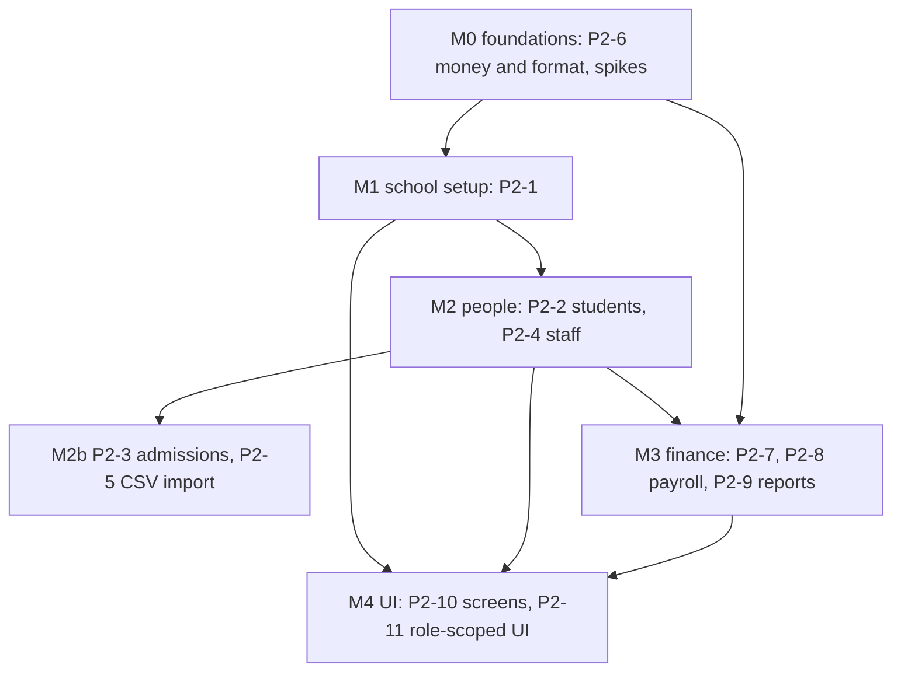

# Phase 2 Plan: School ERP Core & Finance

> Status: **proposed, 2026-10-22.** Product decisions are in ADR-0012. Task IDs follow `implementation_plan.md` §Phase 2; new or changed tasks are marked **NEW** / **CHANGED**. Update statuses here as work lands.

**Phase goal (unchanged):** a school can be configured, populated and billed.

## 1. Starting point (verified 2026-10-22, not assumed)
| Fact | Evidence |
|---|---|
| Phase 1 gate met except P1-15 (reviewers) and the waived staging deploy | `phase1_plan.md`; 570 real-emulator gateway tests; CI green on `staging` |
| Tenant tables exist but are thin | `schema.gql`: `Student` (name, enrolment id, grade level), `ParentGuardian`, `AcademicYear`, `Classroom`, `Subject`, `Invoice` (amount, due date, status), `Payroll` (amount, pay date, status) |
| Everything needed for Phase 2 tables is **missing** | no grade/section, department, staff profile, application, fee structure/item/instalment, concession, payment, receipt, salary structure, payroll run/line, ledger entry, document |
| The platform to build on works end to end | gateway guards, audit-in-transaction, typed client, shared UI (18 components), web-admin shell with `/me` navigation, owner/school/first-admin flows, R2 upload addresses |
| Roles and resources are already modelled | `packages/rbac` matrix covers `students`, `academics`, `admissions`, `staff`, `finance`, `payroll`, `settings`, `reports_*`, `dashboard_*`; navigation items for each exist |
| Money helpers exist but not formatting | `packages/api-client/src/money.ts`: Int64 string parsing and basic `formatMinor`; no rounding rules, no per-school formatting, no Dart side |

## 2. How each module is built (the same shape every time)
1. **Data Connect operations**: every one takes `$schoolId`, filters by it, `@auth(level: NO_ACCESS)`; every mutation writes its audit row in its own `@transaction`; a unique key wherever a duplicate would be a bug.
2. **Gateway module**: DTO classes (whitelist, no body `schoolId`), `@Permission(resource, action)`, `@Audit` or `@NoAudit`, pagination limits, the closed error list.
3. **Tests**: unit; real-emulator (the cross-tenant and role matrix covers new routes automatically; add the audit sample and the module's own rules); a mutation check on each rule.
4. **Contract**: `openapi.json` and the typed client regenerate; the contract test knows any new route class.
5. **UI** (P2-10) uses the shared components, the shell's navigation, words from `packages/i18n` (+ glossary terms), right-to-left checked.

## 3. Workstreams

### M0 Foundations
| ID | Task | Size | Acceptance |
|---|---|---|---|
| P2-6 BUILT (`packages/format` + Dart twin `OruFormat` in flutter-core; 133 TypeScript tests and the same vectors in Dart, expected values from an independent Python implementation; 11 of 11 mutants killed) | **Money and format library** (TypeScript + Dart from one set of test vectors): integer minor units, rounding (half-up to the minor unit, never `Number`), currency and locale from the school, Indian grouping (`₹1,82,40,000`), dates (`Tue, 24 Jun`), times (`8:45 AM`), in all 19 languages' number formats where the platform supports them | S | `packages/format/vectors.json` is run by both the TypeScript tests and the Dart tests with identical results; mutation-checked |
| P2-0a NEW | **Spike: receipt numbers and invoice uniqueness** under concurrent writes (counter row in a transaction, unique keys, retry) on the emulator | S | 100 parallel payments give unique, gap-free numbers per school and year; duplicate invoice generation creates nothing |
| P2-0b NEW | **Spike: PDF with Hindi and Urdu text** (candidate: PDFKit with fontkit; the bundled Noto fonts) | S | a receipt PDF with Devanagari and Nastaliq text renders with correct shaping (inspected); otherwise the decision in ADR-0012 applies |
| P2-0c NEW | **Spike: Data Connect aggregates and pagination** (sum of `*Minor` as Int64, counts, filtered lists with limit and offset, N+1 behaviour) | S | numbers equal an independent sum; list of 5,000 rows pages correctly |

### M1 School setup
| ID | Task | Size |
|---|---|---|
| P2-1 | School configuration: **grade levels** (seeded Nursery, LKG, UKG, 1 to 12; editable), **sections**, classrooms, subjects, **academic years (exactly one active)**, school profile and **branding Mode A** (logo through the R2 upload address, one primary colour checked at 4.5:1 with white text, derived hover/text/soft/focus preview before save), locale default `en-IN` | M |

### M2 People
| ID | Task | Size |
|---|---|---|
| P2-2 | Students: create, edit, list with search, filters and pagination, enrolment ids (school prefix plus a race-free sequence), class placement per academic year, guardians through `ParentGuardian` (a guardian is invited, never auto-created with a password), photo and documents in a **private** bucket | L |
| P2-4 | Staff: profile, department, role through memberships (only a System Admin grants roles), onboarding through the existing account flow, documents (private bucket) | L |
| P2-3 | Admissions: application, review, admit (Principal or Admissions Officer rules from the matrix), admitting creates the student and sends guardian invitations; every step audited | M |
| P2-5 | CSV import (students, staff, guardians): a **dry run that never writes** reports every problem by row and column; the real import is one audited batch | M |

### M3 Finance (needs M0 spikes)
| ID | Task | Size |
|---|---|---|
| P2-7a | Fee structures (per class level and academic year), fee items with instalments, concessions | M |
| P2-7b | Invoice generation per student per instalment, **idempotent**; manual payment recording (cash, cheque, bank transfer, UPI reference), partial payments; outstanding and ageing | L |
| P2-7c | Receipts: numbered, web page and PDF (ADR-0012) | M |
| P2-8 | Payroll: salary structures with components, manual deduction lines, monthly run draft to approved to paid (approval by Principal only, ADR-0007), payslips; statutory calculation is out (ADR-0012) | L |
| P2-9 | Ledger and reports: collections, dues, payroll summary, CSV and PDF export | M |

### M4 Screens
| ID | Task | Size |
|---|---|---|
| P2-10 | Web ERP screens for all of the above, and the dashboard (fees collected, dues, strength) | XL |
| P2-11 | Role-scoped UI: the Bursar sees no academics and the Academic Admin sees no finance, because the gateway returns 403; the UI only omits | M |

## 4. Gate (the phase closes only when all pass)
- **E-RBAC-FULL:** the Finance and Academic isolation matrix is automated over every new route.
- **E-FIN-1:** no floats anywhere; rounding and totals follow the shared vectors in TypeScript and Dart.
- **E-FIN-2:** invoice generation is idempotent; receipts sum to their payments; receipt numbers are unique and gap-free per school and year under concurrent payments.
- **E-TEN-2:** every new endpoint refuses another school (the matrix generates the cases).
- **E-IMP-1:** an import dry run writes nothing (proved by counting rows before and after).
- **E-AUD-1:** every new write route has an audit row in its own transaction.
- A **seed script** makes a demo school with classes, students, staff, fees and payments (the owner can click through it).
- Docs, ADRs and `CLAUDE.md` "Current reality" updated.

## 5. Risks
| Risk | Mitigation |
|---|---|
| Receipt numbers under concurrency | P2-0a spike before any finance code |
| Hindi and Urdu in PDFs | P2-0b spike; the web receipt is the faithful version if shaping fails |
| Data Connect aggregation and paging limits | P2-0c spike; fall back to summing in the gateway in bounded pages |
| Schema changes to tables that already exist (`Invoice`, `Payroll`, `Student`) | no production data yet; planned migration notes in the ADR for each change |
| Student documents and photos are children's data | private bucket, presigned reads, short expiry, audit on every read of a document; DPDP review before pilot |
| Scope size (the phase is the biggest so far) | ship each module vertically (data, gateway, tests) before the next; screens (M4) follow as modules land, not at the end |

## 6. Open items for the owner (none block M0)
1. A real pilot school's spreadsheets (students, fee list, salary sheet) would shape the CSV import columns (P2-5). Until then: a documented template.
2. The legal review of children's data handling (DPDP) before the pilot.
