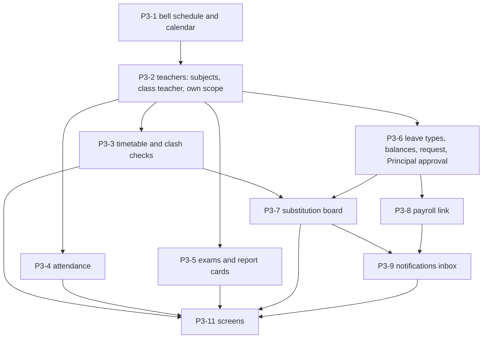

# Phase 3 Plan: Academic Engine

> Status: **proposed, 2026-10-26.** Product decisions are in ADR-0013. Task IDs follow `implementation_plan.md` Phase 3; changes are marked **CHANGED** / **NEW**. Update statuses here as work lands.

**Phase goal (unchanged):** the system knows who teaches what, when, and handles absence correctly.

## 1. Starting point (verified 2026-10-26)
| Fact | Evidence |
|---|---|
| Phase 2 is functionally complete and proven on the emulators | `documentation/phase2_gate.md` |
| The tables a teacher's day needs mostly do not exist | `schema.gql` has only the Phase 0 stubs `ClassSchedule` (string day and time, a `User` as teacher), `LeaveRequest` (status default PENDING, nullable substitute) and `Exam` (no marks); no period, bell schedule, teacher-subject link, class teacher, attendance, mark, grade band, leave type or balance, substitution, notification |
| The stubs have operations that nothing calls | `CreateLeaveRequest`, `UpdateLeaveRequest`, `ListLeaveRequests`, `CreateExam` and an `exams` query in `erp-connector`; no gateway module uses them |
| Roles and resources are already modelled | `packages/rbac`: `attendance`, `grades`, `substitution`, `leave`, `staff_attendance`, `academics`; Principal holds `leave:approve` only; Academic admin full on attendance, grades and substitution; HR manages leave balances and cannot approve; Bursar reads leave; Teacher and Staff hold `own` scope; Parent holds `linked` (read) |
| `own` and `linked` scopes cannot be resolved yet | the gateway returns an empty list or 404 for them (a teacher has no link from account to staff record to classes); Phase 3 supplies the links |
| Guardrails to honour | `guardrails.md` section 4: unpaid leave must raise a payroll deduction alert AND a substitution alert; leave goes through Principal approval with no bypass; attendance statuses are the fixed seven (label editable only) |
| The platform to build on works | gateway guards and audit-in-transaction, typed client, 18 shared components, web-admin screens for every Phase 2 module, PDF kit, i18n with glossary evals, demo school (`npm run demo`) |

## 2. How each module is built (same shape as Phase 2)
1. **Data Connect operations**: take `$schoolId`, filter by it, `@auth(level: NO_ACCESS)`; every mutation writes its audit row in its own `@transaction`; unique keys wherever a duplicate or clash would be a bug (so a race cannot win).
2. **Gateway module**: DTO classes, `@Permission`, `@Audit` or `@NoAudit`, closed error list; own/linked scopes resolved through the staff link, not guessed.
3. **Tests**: unit and pure-rule tests (clash, free-teacher search, grade bands, leave days, deduction), real-emulator end-to-end, a mutation check on each rule; the generated matrix covers the new routes.
4. **Contract**: `openapi.json` and the typed client regenerate.
5. **Screens** (P3-11): shared components, words from `packages/i18n` with glossary terms, right to left checked, per-role proof extended (`role-scoped.test.tsx`).
6. **Enum rule**: never add an enum value and use it in the same deploy. New enums, not extended ones (ADR-0013 consequences).

## 3. Workstreams

### M0 Foundations
| ID | Task | Size | Acceptance |
|---|---|---|---|
| P3-1 BUILT (backend; `/v1/academics/schedule`, `/schedule/working-days`, `/schedule/template`, `/periods`: the school's one bell schedule as periods with start and end times and a break flag, ordered by time and numbered 1, 2, 3 ... for teaching periods; overlaps, a repeated label or start time and an end that is not after the start are refused naming the rule; the database keeps labels and start times unique per school; working days default to Monday to Saturday and are kept in week order; a starting schedule (STANDARD: 8 periods, a short break and lunch; SHORT_DAY: 5 periods and a break) fills an EMPTY school in ONE transaction with one audit row, and two at once cannot both fill it; reading is open to every scope, changing it is the Academic administrator's; 8 database tests and 7 end-to-end tests; 5 audit samples; screens are P3-11) | **Bell schedule and working days** (**CHANGED**: Period/TimeSlot made concrete): school settings for working days (default Monday to Saturday) and an ordered list of periods (label, start, end, break or teaching); a "start from a template" choice; editing a period used by timetable entries is refused unless its times only | S | periods cannot overlap or run backwards; days are real weekdays; audit rows; screens in P3-11 |
| P3-2 BUILT (backend; `GET /v1/academics/teachers`, `POST/DELETE /v1/academics/teachers/:staffId/subjects`, `PUT/DELETE /v1/academics/classes/:id/teacher`, `GET /v1/academics/mine`, `GET/POST/DELETE /v1/students/:id/parent-accounts`: which subjects each active member of staff teaches (one link per pair, by key); one class teacher per class per year (by key; setting again changes it); the link from a parent's sign-in account to a student (only an active PARENT member of this school can be linked). **Own and linked scopes now resolve**: a Teacher (`own`) sees only the classes they are class teacher of, through the staff record linked to their account (`PUT /staff/:id/account`), and a Parent (`linked`) only the classes of their linked children, on `GET /academics/classes` and `/academics/levels`; with no link nothing is visible. `GET /academics/mine` tells any caller what their scope resolves to. The old `ParentGuardian` table (no school column) is replaced by `ParentLink` (with one), which closes the plan's "every tenant table has a school column" gap; 6 database tests and 6 end-to-end tests; 6 audit samples; the timetable (P3-3) will add the classes a teacher teaches to their own scope) | **Teachers**: `TeacherSubject` (which staff teach which subject), `ClassTeacher` (one class teacher per class per year), and the **link account to staff record** that resolves `own` scope (a teacher's classes, students, marks, attendance) and `linked` scope for parents (their children) | M | a Teacher account sees only own classes; a Parent only their children; a class has at most one class teacher per year (unique key); matrix cases generated |

### M1 Timetable
| ID | Task | Size | Acceptance |
|---|---|---|---|
| P3-3 BUILT (backend; `GET /v1/academics/timetable/classes/:id`, `/teachers/:staffId`, `/mine`, `/load`, `PUT /v1/academics/timetable/classes/:id/slots`, `DELETE /v1/academics/timetable/entries/:id`: `TimetableEntry` replaces `ClassSchedule` (dropped on deploy, with its two unused operations); two unique keys (year+class+day+period, year+teacher+day+period) make a clash impossible, and the gateway names it first (409 `classBusy` / `teacherBusy`); the teacher must be active and teach the subject, the period must be a teaching period, the day a working day; a period in use cannot be deleted or become a break (409 `periodInUse`); a teacher's own scope now also covers the classes in their timetable; weekly load per teacher; 6 database tests, 8 end-to-end tests including two parallel requests for one slot, 2 audit samples; the editor screens are P3-11) | **Timetable model and editor** (replaces `ClassSchedule`): `TimetableEntry` (year, class, subject, staff, day, period); views per class and per teacher; hard clash refusal naming the clash (teacher, class) | L | **E-ACAD-1**: two entries for one teacher or one class at the same (day, period, year) are impossible (database unique keys), proved with parallel requests; a teacher's weekly load is reported |
| P3-3b | **Timetable auto-generation** (greedy then backtracking; manual cells always win) | L | optional second delivery: a generated timetable has zero clashes; the editor can override any cell |

### M2 Attendance and exams
| ID | Task | Size | Acceptance |
|---|---|---|---|
| P3-4 BUILT (backend; `/v1/attendance/statuses`, `/classes/:id/days[/:date]` (read, submit, `/lock`, `/correction`), `/missing`, `/students/:id`, and `/v1/attendance/staff` (check-in, check-out, mine, presence, HR correction): `AttendanceDay` with a unique key per class and date, `AttendanceMark` (exceptions only, one row per student per day by a derived id), `AttendanceStatusLabel`, `StaffAttendance`; the seven statuses are a database enum and only their label can be set; a submit is make-day, write-marks, then one audited finishing step, and a replay of the same `submissionId` changes nothing; a locked day refuses the teacher (409 `dayLocked`) and the Academic admin's correction is audited with each old and new value; a Teacher marks only classes they are class teacher of; a Parent reads only a linked child; 6 database tests, 12 end-to-end tests, 7 audit samples. Dates are taken in India Standard Time until a school timezone exists) | **Attendance server model and APIs**: `AttendanceDay` (class, date, locked), `AttendanceMark` (student, one of 7 fixed statuses, note); exception-based bulk submit (everyone not listed is present); per-class daily lock; corrections audited with before and after; staff check-in and check-out (`StaffAttendance`); label-only status settings; idempotent submit (client-supplied id) | L | **E-ATT-1**: only the 7 keys exist, a label edit never changes a key or colour; a locked day refuses a teacher's edit, and the Academic admin's correction is audited with the old value; a replayed submit changes nothing; a teacher can mark only own class |
| P3-5 BUILT (backend; `/v1/grades/terms`, `/bands` (with a starting set offered), `/exams`, `/exams/:id/marks`, `/report-cards/students/:id` and `/pdf`: `AssessmentTerm`, `Exam` (replaces the stub, a DROP and re-create on deploy), `Mark` (whole tenths, absent flag); the school's grade bands are one set kept on the school and accepted only from 0 to 100 with no gap or overlap; a mark above the maximum is refused by the database; percentages are an integer product divided by the maximum, rounded down, so 89.9 is never an A1; a teacher enters marks only for a subject they teach in a class of theirs; the report card adds up (subject = sum of its exams, total = sum of subjects; absent is zero; unmarked is pending); the PDF reuses the report-table PDF in the school's language; 21 unit cases with shared vectors, 6 database tests, 8 end-to-end tests, 8 audit samples, evals in `evals/phase3-academic.test.mjs`; **Hindi and Urdu PDFs are proven to render a valid file, not yet looked at by a person**) | **Exams and grading** (replaces `Exam`): `AssessmentTerm`, `GradeBand` (school-defined), `Exam` (term, class, subject, date, maximum), `Mark` (tenths of a mark, absent flag); mark entry by the subject teacher or Academic admin; per-student result with percentage and grade by integer arithmetic; **report card** JSON and PDF (shared PDF kit, school language) | L | **E-EXAM-1**: marks and percentages never use floating point and equal the shared vectors; a mark above the maximum is refused; bands cannot overlap or leave gaps; the report card total equals its marks; Hindi and Urdu PDFs render |

### M3 Leave, substitution, payroll
| ID | Task | Size | Acceptance |
|---|---|---|---|
| P3-6 BUILT (backend; `/v1/leave/types`, `/balances`, `/requests` (+ `/cancel`, `/approve`, `/reject`): `LeaveType` (paid or unpaid, yearly allowance), `LeaveBalance` (made at the first request from the type's allowance, HR can change it but never below days taken), `LeaveRequest` (new, with the new enum `LeaveRequestStatus` PENDING, APPROVED, REJECTED, CANCELLED; the stub is replaced on deploy); days are counted in half-days over the school's working days, a half day is one half-day, a request lies in one academic year; **only an active Principal approves or rejects, checked by the database in the transaction that takes the days from the balance** (a stale balance is refused, so two approvals cannot spend the same days); overlapping requests of one person are refused by the gateway when asked and again at approval (not by a database key); 6 unit cases, 4 database tests, 7 end-to-end tests, 8 audit samples, structural eval E-ACAD-4 in `evals/phase3-academic.test.mjs`; substitution (P3-7) and the payroll proposal (P3-8) read approved leave and are next) | **Leave**: `LeaveType` (paid or unpaid, yearly quota), `LeaveBalance`, new `LeaveRequest` (staff, type, dates, half days, reason; PENDING, APPROVED, REJECTED, CANCELLED); employees request their own (own scope); **only an active Principal approves, checked by the database**; approval takes the days from the balance in the same transaction | M | **E-ACAD-4**: no route or operation reaches APPROVED except the Principal's approve; HR, Bursar, Academic admin and the requester are refused (matrix plus database test); a refused approval changes nothing; overlapping requests of one person are refused |
| P3-7 BUILT (backend; `GET /v1/substitutions/needs`, `/suggestions`, `/mine`, `PUT /v1/substitutions`, `DELETE /v1/substitutions/:id`: the need is DERIVED from APPROVED leave over the absent teacher's timetable on working days (a half day of leave covers the morning or afternoon, the day split at the midpoint of the teaching periods), so it exists at the moment of approval with no extra step to forget; only the decision is stored (`Substitution`, id derived from lesson and date); suggestions are people free in that period, not on leave, not already substituting and teaching the subject, fewest substitutions this month first then by name; the Academic admin confirms or changes; the database re-checks every rule and two unique keys (lesson+date, substitute+date+period) stop a double-booking under parallel requests; clearing or changing a lesson in the timetable takes its cover with it; 205 unit cases including a 200-seed property test, 5 database tests, 7 end-to-end tests, 2 audit samples; notifications are P3-9) | **Substitution**: on approval, the affected slots (the teacher's timetable entries on working days in the range) become `Substitution` rows needing a substitute; a **suggestion search** (free in the slot on the date, not on leave, not already substituting, teaches the subject, fewest substitutions this month first); the Academic admin confirms or chooses | L | **E-ACAD-2**: a property test over random timetables and leave: every suggestion is free and qualified, and no assignment can double-book a substitute (database unique key); nothing is assigned without the Academic admin |
| P3-8 BUILT (backend; `GET /v1/payroll/runs/:id/leave-proposals` and `POST /v1/payroll/payslips/:id/leave-deduction`: a proposal is DERIVED from APPROVED UNPAID leave and the payslip's gross, so the approval of the leave raises it at the same moment it raises the substitution need (E-ACAD-3: both for unpaid, only the need for paid); the cut is gross x half-days / (2 x the school's working days that month), bigint paise rounded down, clipped to the run's month; HR applies it as an ordinary deduction line named `Unpaid leave`, at the proposed amount or an edited one, once, only on a DRAFT run (the Principal still approves the run); nothing is applied silently; 3 unit cases with vectors, 4 end-to-end tests, 1 audit sample, eval E-ACAD-3) | **Payroll link**: approved unpaid leave proposes a deduction line per person in the month's payroll run (rule in ADR-0013 decision 8, a pure function), editable by HR before approval | M | **E-ACAD-3**: an approved unpaid leave raises BOTH a substitution need and a payroll proposal in the same transaction (guardrail section 4); a paid leave raises only the substitution; the proposal is never applied silently; rounding follows the money rules |

### M4 Notifications, sync groundwork, screens
| ID | Task | Size | Acceptance |
|---|---|---|---|
| P3-9 BUILT (backend; `GET /v1/notifications`, `POST /v1/notifications/:id/read`, `/read-all`, `GET/PUT /v1/notifications/preferences/:category`: an in-app inbox; a notification is written by the SAME database transaction as its cause (leave asked: to the Principal role; leave approved or rejected: to the requester; approved leave: to the Academic admin role for substitutes, and for unpaid leave also to the HR role for the payroll proposal; cover chosen or cleared: to that teacher); a notice is addressed to a staff record (seen through the linked account, now or later) or to a role, and a person reads only their own (database-checked); read markers are per person; the words are made from `packages/i18n` keys in the reader's own language (English for a missing key; Hindi and Urdu are drafts); a person can switch a category off (kept, not shown); every role, parents included, holds the new `notifications` grant at own scope; push (FCM) and SMS stay behind Phase 4; 3 unit cases, 5 database tests, 7 end-to-end tests) | **Notification service** (**CHANGED**: FCM moves to Phase 4): in-app inbox, templates in the user's language, per-user preferences, a sender interface (FCM and SMS adapters later); events: leave decided, substitute assigned, unpaid-leave alerts | M | a notification is written in the same transaction as its cause; a user reads only their own; templates come from `packages/i18n` |
| P3-10 BUILT (`documentation/modules/offline-sync.md` with the conflict rule for every Phase 3 entity; `GET /v1/sync/tombstones` and `Tombstone` rows written in the same transaction as the removal of a lesson, a cover, an attendance exception or a mark, filtered by what the caller may read; leave requests accept a `clientId` (unique per person) so an offline retry returns the first; the end-to-end test replays attendance, marks, timetable slot, status label, check-in and leave request three times each and shows one result; the engine itself is Phase 4) | **Sync groundwork and `modules/offline-sync.md`** (**CHANGED**: the engine is Phase 4): conflict rules per entity written down; server pieces the engine needs: client-supplied ids make attendance and mark submission idempotent, tombstones for removable records | M | replaying any submission any number of times leaves one result; the document covers every Phase 3 entity |
| P3-11 IN PROGRESS (slice 11d built: **Leave** (requests with person, type, dates and half days, days and status; only the Principal sees Approve and Reject, and rejecting asks first with an optional note; leave types for HR with the paid or unpaid choice and yearly days; each person's allowance, which HR may change but never below days taken), the **Substitution board** (lessons that approved leave leaves uncovered, with who is away and who covers; the Academic admin chooses from the people who are free and qualified, fewest covers this month first, changes or removes cover, and every refusal is explained) and the **unpaid-leave proposals in a pay run** (HR applies the proposed deduction or edits the amount first; nothing is deducted by looking); slice 11c built: **Gradebook** (marks entry of one exam: marks as typed, an absence tick, percentage and grade; only the students changed are sent with the device's own id; terms and exams with add and remove; the grade-band editor with the standard set to start from and every refusal explained; a student's report card with the exams under each subject, a total that adds up, what is pending and the PDF download in the person's language); slice 11b built: **Attendance** (daily register of a class on a date with each student's status and the counts, the Academic admin marks exceptions and saves with the device's own id, locks a day, and corrects a locked one; classes that have not taken attendance; the school's own names for the seven statuses) and **Staff attendance** (who is at work on a date, times in Indian Standard Time, HR's correction); slice 11a built: **Timetable** screen in web-admin with three views, by class with the lesson editor (the teacher list holds only people who teach the subject; refusals are explained in the school's language: class or teacher already busy, not a working day, period in use), by teacher with the weekly load, and the bell schedule with working days, starting from a standard or short day, adding and removing periods; new `timetable` navigation item under Academics for roles with the academics grant; the role-scoped proof covers it; next slices: attendance, exams and report cards, leave and substitution, notifications bell) | **Web screens**: bell schedule and working days, timetable (class and teacher views, editor), attendance review and correction, exams and mark entry, report cards, leave requests and Principal approvals, leave types and balances, substitution board, notifications | XL | the role-scoped proof covers them (no call a role is not granted); per-slice, as in Phase 2 |
| P3-12 | **Demo school extended** with a bell schedule, timetable, a month of attendance, an exam with marks and a report card, leave in every state and a substitution | S | `npm run demo` seeds them; `documentation/demo-school.md` updated |

## 4. Gate (the phase closes only when all pass)
- **E-ACAD-1:** no teacher and no class is double-booked, by database key, proved under parallel requests.
- **E-ACAD-2:** a suggested or assigned substitute is free in the slot and qualified for the subject (property test).
- **E-ACAD-3:** unpaid leave raises the payroll deduction proposal and the substitution need together (guardrail section 4); paid leave only the substitution.
- **E-ACAD-4:** leave approval cannot be bypassed: only an active Principal, enforced in the database; every other role and route refused.
- **E-ATT-1:** the seven statuses are fixed (label only editable), daily lock and audited corrections work, replay is idempotent.
- **E-EXAM-1:** no floating point in marks, percentages or grades; shared vectors; bands without overlap or gap.
- **E-RBAC-FULL and E-TEN-3:** the generated matrix covers every new route; own and linked scopes tested for Teacher and Parent.
- **E-AUD-1:** every new write route audited in its own transaction.
- Demo school extended (P3-12); docs, ADR and `CLAUDE.md` "Current reality" updated; a gate review page like `phase2_gate.md`.

## 5. Risks
| Risk | Mitigation |
|---|---|
| Clash rules enforced only in code can be raced | unique keys in the schema (decision 6); parallel-request test in the gate |
| Free-teacher search is correct in the small and wrong in the large | it is a pure function with a property test over random timetables, separate from the HTTP layer |
| `own` scope has never been resolved, so teacher routes could leak or hide | P3-2 first; the matrix gets own-scope cases for every attendance, mark and leave route |
| Approval bypass through a new path (a patch, an import, a status field) | status changes only through named actions; database check on the Principal; a test lists every operation that can write the status |
| Unpaid-leave deduction rule differs per school | one pure function with tests; shown as an editable proposal, never applied silently |
| Enum and schema changes on tables that exist | new enums and new tables; DROP of the three stubs on deploy; `sql:diff` read before deploying |
| Scope size (the phase is larger than Phase 2) | vertical slices: data, gateway, tests, screens per task; the solver (P3-3b) and FCM are deferred |

## 6. Open items for the owner
Answered 2026-10-26 (ADR-0013 decisions 10 to 13); nothing blocks the build.
1. ~~Unpaid-leave deduction rule~~ **decided:** monthly gross divided by the school's working days of that month; HR can edit the proposal.
2. ~~Half-day leave~~ **decided:** allowed.
3. ~~Grade band template~~ **decided:** a starting set is offered and is editable. (The exact starting values are mine to propose when P3-5 is built; the owner reviews them on the screen.)
4. ~~A real timetable~~ **decided:** none yet; made-up data first. A real one can be added as a test case at any time.
5. **Firebase Cloud Messaging project** is needed in Phase 4, not now; the owner can create it any time.
