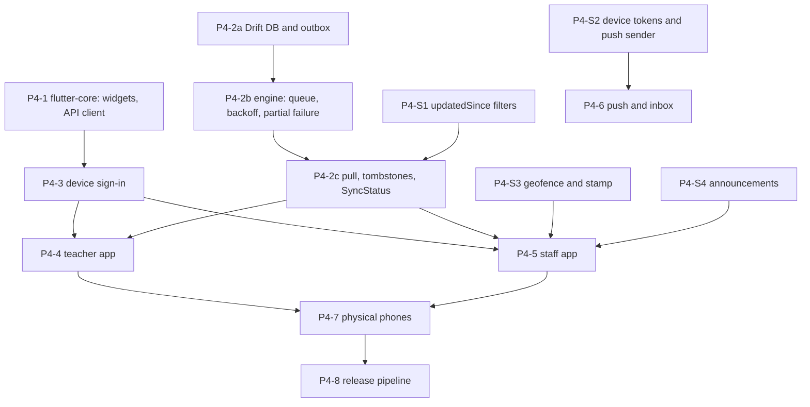

# Phase 4 Plan: Teacher and Staff Mobile (offline-first)

> Status: **accepted, 2026-10-27.** Product decisions are in ADR-0014 (owner answers 2026-10-27). Task IDs follow `implementation_plan.md` Phase 4; changes are marked **CHANGED** / **NEW**. Update statuses here as work lands.

**Phase goal (unchanged):** staff do their daily work with no connectivity and never lose data.

## 1. Starting point (verified 2026-10-27)
| Fact | Evidence |
|---|---|
| Phase 3 is built; its gate page is `documentation/phase3_gate.md` | the gate suites were rerun after the merge (see that page for the result) |
| The server half of offline sync exists: idempotent submissions, tombstones, written conflict rules | `documentation/modules/offline-sync.md`; `GET /v1/sync/tombstones`; `submissionId` on attendance and marks, `clientId` on leave requests |
| The Flutter side is a shell | `packages/flutter-core/lib/flutter_core.dart` exports only locales, localization, theme, tokens and `OruFormat`; `pubspec.yaml` has no Drift, connectivity, secure storage, Firebase or HTTP dependency; `apps/mobile-teacher` and `apps/mobile-staff` hold a themed foundation screen |
| The 18 design-system widgets are not written in Dart | the library header says they "arrive in Phase 4"; the React twins are in `packages/shared-ui` |
| Tooling is present | Flutter 3.47.5 and Dart installed; CI job `flutter` in `.github/workflows/periodic-checks.yml`; Melos workspace |
| No server support yet for | device tokens and push, an `updatedSince` filter on lists, a school geofence and a check-in stamp, announcements |
| No physical phone, no FCM project, no store accounts | owner items in section 6 |

## 2. How each part is built
1. **Server additions** follow the Phase 3 shape: a Data Connect operation with `$schoolId` and an actor check, the audit row in its own `@transaction`, a DTO-validated gateway route with `@Permission` and `@Audit`, real-emulator tests, the generated matrix, regenerated `openapi.json` and typed client.
2. **Dart code** is tested at the unit level (`melos run test`) and the sync engine is also run against the **real gateway and emulators** from a Dart test harness (the same "real, not mocked" rule as the gateway). Library versions and APIs are read from `pubspec.lock` and the package docs before use.
3. **Every string** is a `packages/i18n` key; Hindi and Urdu stay drafts; right-to-left and 48 px targets are checked by widget tests.
4. **Screens** are built per slice, each with a screenshot (`flutter test` golden or simulator capture) put in the Project Hub, as in Phase 3.
5. **No blocking spinners** on core flows (the local database is what the screen shows). Sign-in and the payment-like actions that need the network say so in words.

## 3. Workstreams

## 4. Tasks
### M1 Foundations
| ID | Task | Size | Acceptance |
|---|---|---|---|
| P4-1a BUILT (16 widgets plus a link action in `packages/flutter-core/lib/src/widgets`, named `Oru*` to avoid Material's `Card`, `Checkbox`, `TextField` and `Badge`; the six sync states take their wording from the catalogue; widget tests cover 48/64/112 px targets, 13 px text, Urdu right to left, no overflow at 360 px width; found and fixed two real faults while testing: the stat card's trend row overflowed and the neutral action tile asserted; **not built:** `SideNav` (web only) and `Logo` (needs the brand artwork, with the splash screen in P4-3)) | **Widgets** in `flutter-core`: the 18 components with the names, props and wording of the design system (batches as in the React library), icons through the Lucide map, touch density 48 (Driver 64 later) | XL | a widget test per component; nothing under 13 px or 48 px; right-to-left mirrors; no hex or literal copy (the drift rule checks) |
| P4-1b BUILT (the Dart client is GENERATED from `openapi.json` for the 38 operations the two apps use, listed in `packages/api-client/scripts/dart-operations.json`: 84 models and a typed `OruApi`, error codes, and a route table with each route's access class; `npm run generate:dart -w @oruschools/api-client`, and `npm test` fails if it is stale; the hand-written `OruHttpTransport` sends the token and school as the web client does, retries a 401 once with a fresh token, and turns the envelope, a timeout and no network into `OruApiError`; 19 unit tests, and `tools/tests/dart-gateway.sh` ran the client against the REAL gateway and emulators with the demo school: 3 tests parse real teacher and admin payloads and the refusals; it found and fixed a real gateway fault: `/v1/me` returned school ids without dashes, which the `X-School-Id` header refuses) | **API client and error handling** in `flutter-core`: a Dart client for the gateway's closed error list, generated or hand-written from `openapi.json` (decide in the task; if hand-written, a test fails when `openapi.json` changes without it), request id, school header | L | the client calls `/v1/me` against the real gateway in a test; each error code maps to one message key |
| P4-2a BUILT (in a NEW package `packages/flutter-sync`, not in `flutter-core`: Drift needs `sqlite3`'s build hook, and keeping it apart leaves every `flutter-core` test free of native-asset builds; tables `outbox_items`, `sync_cursors`, `local_records` (a record per gateway entity type and id, with a parent id, so a tombstone removes exactly one row and what hung off it), `drafts`, `device_meta`; `OruLocalStore` holds the whole queue contract: client ids make a double enqueue one change, order is a counter and never the clock, a child waits for its parent, a retry waits out its backoff, a refusal is final and fails what waited on it, a change interrupted mid-send is owed again at the next open, sign-out wipes everything; 25 tests on real SQLite including a 400-step random run and file-backed kill-and-reopen; the tests found and fixed two real faults: a subquery that compared a row with itself, and a change queued behind an already-refused parent that waited for ever; the schema is v1, so there is no earlier version to migrate from yet: every later change adds a step and a dumped-schema test) | **Local database and outbox**: Drift schema for the entities the two apps show; outbox table (UUID, kind, body, `createdAt`, attempts, state) | L | migrations tested up from an empty and a previous version; the outbox survives a process kill (test) |
| P4-2b BUILT (`SyncEngine` in `packages/flutter-sync`: one change at a time, oldest first, parents before children; accepted removes it, a 4xx is final and fails what depended on it, a 5xx or rate limit is backed off and the rest carry on, two network failures in a row mean offline and stop the pass, a 401 after a fresh token stops everything without losing or counting anything until `signedIn()`; backoff is 2 s doubling to 5 min with half-random jitter and the server's own retry-after as a floor; it wakes itself when the soonest retry is due; connectivity is a stream and an initial check handed in by the app (the platform plugin is wired in P4-3/P4-4, not here); `OruApiSender` sends the six queued kinds through the generated client with the outbox id as `submissionId`/`clientId`; 16 engine tests incl. a 300-run random-failure property, a kill-and-reopen test, and 5 tests against the REAL gateway on the emulators for E-SYNC-1, 1b (answer lost twice), 3, 4 and the 401 path, mutation-checked) | **Sync engine, push side**: connectivity watcher, exponential backoff with jitter, send oldest first, parents before children, one failing item never blocks the rest (a 4xx is final and surfaced; a 5xx or timeout retries) | XL | **E-SYNC-1 to E-SYNC-4** below |
| P4-2c BUILT (`SyncCoordinator.syncNow()`: push first, then each `PullTask` (a whole list replaces the local copy; a list per parent replaces each parent's records), then removals from `GET /v1/sync/tombstones` page by page; a page of removals and its cursor are applied in one transaction, so the cursor never passes a removal that was not applied; the first ask starts at the beginning of history because the device clock is never used to guess (rule 4); a pull that cannot reach the server shows offline, one the server refuses shows failed, and neither moves anything; `deriveSyncState` is the single rule from the queue counts, the engine and the last pull to the six states (failed > syncing > offline > pending or saved > synced); `OruApiTombstones` is the source over the generated client; 15 tests incl. every combination of inputs, a 400-event random run where the state always equals the queue, and E-SYNC-5 against the real gateway: a lesson the Academic admin removes disappears from the teacher's phone only by tombstone, and the status goes offline then synced; mutation-checked both ways; per-screen pull tasks come with the screens in P4-4/P4-5; `updatedSince` filters are P4-S1, so lists are pulled whole until then) | **Sync engine, pull side and `SyncStatus`**: pull by endpoint (`updatedSince` where added), apply tombstones, the six visible states with fixed wording | L | **E-SYNC-5**; the state shown always matches the queue (property test over random event sequences) |
| P4-3a BUILT (new package `packages/flutter-auth`, pure Dart: `FirebaseRestIdentity` signs in by password or phone code, refreshes and sends password-reset mail over Firebase's REST interface, so there is no native auth plugin and the same code runs against the Auth emulator; `DeviceSession` keeps only the refresh token in secure storage (the id token lives in memory), asks `/v1/me` which schools fit the app by role, remembers the school, wipes local data when the person, the school or the membership changes or the account is revoked, and warns before signing out with changes owed; `tokenProvider` is what `OruHttpTransport` takes: refresh a minute early, one refresh for many callers, `NETWORK_ERROR` when offline, `AUTH_REQUIRED` when Firebase refuses; `AppLock` is the optional re-entry (off by default, only on after the phone's own check passes, never signs out); 29 session and lock tests, 7 identity tests and 7 against the real gateway and Auth emulator: password and phone-code sign-in, wrong password and unknown email look the same, an account of another role is refused, reopen, hours-later-offline keeps the session and the school, a deleted account wipes the phone; mutation-checked; **not built, in P4-3b:** the sign-in and school-choice screens with their `packages/i18n` strings, the app wiring, and the platform pieces behind the two ports (Keychain/Keystore storage, biometrics) and the phone-code app check, which need a device or simulator) | **Device sign-in**: Firebase sign-in, secure token storage, school choice, optional lock, a session that survives being offline until the token cannot refresh, sign-out deletes local data | M | tests with the Auth emulator; an expired token offline keeps the local data readable and refuses only new network work |
| P4-3b BUILT (screens in `packages/flutter-auth` (`flutter_auth_ui.dart`): sign-in by email and password or by phone code, forgot password with one answer for every address, school choice, the lock screen, a sign-out confirmation that says how many changes would be lost, an account panel with the lock switch; `OruSessionGate` shows the opening moment, then sign-in, school choice, the lock or the app; new package `packages/flutter-app` holds the shell both apps share: `OruAppConfig` (dart-define), the phone's real pieces behind the ports (Keychain/Keystore, local_auth, connectivity_plus, the SQLite file), `OruServices` wiring session, database, queue, engine and coordinator and running the engine while a school is open, and the signed-in home with the sync status; `mobile-teacher` (Teacher) and `mobile-staff` (Staff, HR, Bursar, Academic admin, Principal) boot through it; 19 new strings in en, hi and ur (hi and ur are unreviewed drafts); found and fixed by looking at the pictures: Urdu text in left-to-right fields and sentences came out reversed (new `textDirection` on `OruTextField`, number isolates) and screen titles used a style the theme does not define so Urdu showed empty boxes; found by running the staff app: HR and Bursar may not read academics, so the removals request was refused and the status showed Sync failed (a refusal there now means nothing removed); verified: 47 flutter-auth tests, 3 flutter-app tests, and an integration test on the REAL iOS simulator (iPhone 17) for both apps against the real gateway and Auth emulator: sign in, close and reopen (Keychain and SQLite file persist), sign out wipes everything; the Android debug app builds; **not verified:** the app lock on a phone (the simulator has no screen lock set), the phone-code step on a real project (app check), release builds and signing, Android on a device) | **Sign-in screens, secure storage and the signed-in shell** | L | sign in, reopen and sign out on a simulator against the real gateway |

### M2 Server additions
| ID | Task | Size | Acceptance |
|---|---|---|---|
| P4-S1 BUILT (`updatedSince` and `next` on the five lists a phone pulls: own leave requests, the week's lessons, a class's attendance days, an exam's marks grid, notifications; the database gets an `updatedAt` on lessons, leave requests, marks and attendance days, set again by every change; `next` is the newest change the server saw (the database's clock, floored to the millisecond), asking `updatedSince` from there returns what changed at or after it, so the newest row may repeat and nothing is missed; with nothing new the moment stays; a bad moment is a 400; removals still come as tombstones; for notices the moment is when the notice was written, so a notice read on another phone is not re-sent, and `unreadCount` then counts only what was returned; found while building: a `where` on the exam's marks relation in Data Connect replaces the link to the exam instead of adding to it, so the grid filters in the gateway; verified by 7 new tests on the real emulators with a mutation check, the full gateway suite (5984), database (145) and Data Connect (40) tests; the generated TypeScript and Dart clients carry the new field and parameter; the phone uses it with its screens in P4-4/P4-5; the production schema needs the four new columns, with the owner's schema deploy) | `updatedSince` (server time) on the list endpoints a device pulls: class day attendance, marks of an exam, own leave requests, notifications, timetable | M | a list with `updatedSince` returns only what changed; rows removed appear as tombstones; the matrix covers the changed routes |
| P4-S2 BUILT (`POST /v1/devices`, `DELETE /v1/devices` (token in the body, never in a URL) and `GET /v1/devices` for the signed-in account without a school; a `DeviceToken` table whose id is made from the token so a repeat is one row and a phone that changes hands moves to the new account; nobody can remove another account's phone; **the plan's "existing notification sender interface" does not exist**: notices are written inside the database mutations that cause them, so the gateway cannot hook the writing; instead `PushService` runs after a successful write in a school (scheduled and debounced, never part of the request), lists that school's unpushed notices written within `PUSH_WINDOW_MINUTES`, claims each in the database (one gateway instance gets the claim: at most once), finds who it is for (the person, or the active members of the role), skips anyone who muted that kind of notice, and sends to their devices; the message is data only with the notice id and the school id (ADR-0014 decision 7; a silent push on iOS), tokens the provider calls dead are forgotten, a failing provider costs the push and nothing else; `FcmPushSender` over firebase-admin messaging, a no-op sender when `PUSH_ENABLED` is off (the default); verified: 14 unit tests, 10 tests on the real emulators with a recording provider (register, repeat, change of hands, not removable by another, validation, push reaches only the audience with only ids, sent once, provider down, muted, dead token, signed out) with a mutation check, the full gateway suite; **not verified:** real delivery through FCM and APNs (no Firebase project with messaging, no phone: ADR-0014 decision 12), the phone side (registering a token, removing it at sign-out, waking on a push) which is P4-6) | **Device tokens and the push sender**: `POST/DELETE /v1/devices`, a table of tokens per account, an FCM sender behind the existing notification sender interface, a notice also triggers a push (best effort, never blocks the cause) | M | a token belongs to its account only; sign-out removes it; a failing sender cannot roll back the notice (test); push carries the id only (ADR-0014 decision 7) |
| P4-S3 BUILT (the server half: `PUT` and `DELETE /v1/school/geofence` (System Admin: a point, the grounds' radius, the feathered margin, default 50 m; radius plus margin is the soft ring) and `GET /v1/attendance/staff/geofence` (anyone who checks in, so the phone can ask for a reason before sending); `POST` check-in and check-out take an optional `{position, deviceTime, reason}` and always record the day: the server judges the position (`attendance/geofence.ts`, pure and unit-tested) and keeps only the stamp `INSIDE`, `OUTSIDE` or `UNKNOWN`, the distance in whole metres, the reason and the phone's time as a note; the record's time stays the server's; a reason is required only when the school has a geofence and the person is outside the soft ring or sent no position (400 `reasonRequired`, never refused for where they are); beyond the fixed 500 m the check-in waits for HR, who confirms it once with `POST /v1/attendance/staff/:staffId/days/:date/confirm` (audited, HR only, 409 when nothing waits); a repeat check-in is the same answer and the first stamp stands; the position is never kept, and the audit rows hold stamp and distance only (tested); the school's point is stored as millionths of a degree in whole numbers, because the tenancy eval forbids floating point anywhere in the schema; HR's presence list and a person's own days carry the stamp, distance, reason, both times and what waits; 10 unit tests, 9 on the real emulators with a mutation check, the full gateway suite; the Dart client and the outbox sender pass the stamp body; **not built:** the web-admin screens (the geofence setting for the System Admin, and the stamp and Confirm button on HR's staff attendance screen) and the phone's reason prompt, which come with the screens, so today the geofence is set through the API) | **School geofence, check-in stamp and reason**: a point, a radius and a feathered margin (soft ring, default margin 50 m) in the school settings, and a fixed hard ring of 500 m; check-in and check-out accept an optional position, the phone's own time (`deviceTime`, a note) and a reason; the server stores `inside`, `outside` or `unknown`; beyond 500 m HR must confirm (ADR-0014 decision 9) | M | a repeat check-in is still the same answer; a stamp other than `inside` without a reason is refused by the gateway; HR sees stamp, reason and both times; no position is kept beyond the stamp and its distance |
| P4-S4 BUILT (`GET /v1/announcements` (with `updatedSince` and `next`), `GET /v1/announcements/:id`, `POST`, `PATCH /:id` and `POST /:id/withdraw`; every role reads, only the Principal and the Academic admin write (the rbac matrix now gives the Principal create and update on announcements, an explicit exception in the Principal test, and gives the Bursar and the System Admin read, which they lacked although the decision says every staff role reads); posting writes the announcement, one notice per staff role (13, not parents) and the audit row in one transaction (all or none); the notice carries only the title, the words are read from the announcement; a new notice category `announcement` that a person can switch off, and the existing push sends it to phones; editing corrects the words and tells nobody again; withdrawing keeps the row (a phone that has it must hear it is gone) and shows it without its words, repeatable, and an edit after it is a 404; a school sees only its own; 8 tests on the real emulators, the audit and route matrices extended, the rbac and glossary evals; hi and ur wording is a draft; **not built:** the web-admin Announcements screen (the navigation entry exists but has no page) and the staff-app screen, which comes with P4-5) | **Announcements**: written by the Principal and the Academic admin on the web, read by every staff role, delivered as notices | M | write is Principal/Academic admin only; every role reads; a notice per reader is written in the same transaction |

### M3 The apps
| ID | Task | Size | Acceptance |
|---|---|---|---|
| P4-4a BUILT (`OruTodayScreen` in `packages/flutter-app`: the teacher's remaining lessons today in time order (a lesson drops off the minute it ends, breaks never show), her classes with no attendance today, those saved on the phone and not sent yet, and her leave requests waiting for the Principal plus any saved and not sent; it reads only the phone's own database through `TodayController` and the pure `buildToday`, so it works with the network off after one sync, a lesson removed on the server disappears by tombstone, the sync state is always in view, pull down to refresh, and a school day check (a Sunday asks for nothing); the first day says to connect once; pull tasks `todayPullTasks` fetch the week, the bell schedule, her classes and today's attendance days and her leave; `OruTeacherHome` shows Today with the account one tap away (the bottom navigation comes with the second tab in P4-4b); found while building and fixed: the gateway's `/academics/mine` listed classes she only teaches as well as the ones she is class teacher of, and only the second kind takes daily attendance, so it now also returns `classTeacherOf`; `SyncCoordinator.syncNow()` returned at once when a sync was already running, so a pull-to-refresh could return before the data had arrived, it now waits for the running one; signing out from the account page left that page on top of the sign-in screen; Urdu lesson lines came out jumbled until names and times were isolated; verified: 13 model tests (mutation-checked), 7 screen tests (offline, saved changes appear at once, a tombstone, first day, Urdu, a Sunday), a sign-in and sign-out flow test, the pull against the real gateway for the demo teacher, and the whole flow on the real iOS simulator; **not built:** attendance entry (P4-4b), marks (P4-4c), leave request and classes (P4-4d); the school's own time zone is not modelled, so "today" is the phone's date) | `mobile-teacher` **Today**: the teacher's next lessons from the local timetable, classes still without attendance today, pending leave | L | works with the network off after one sync; the six states show |
| P4-4b BUILT (the Attendance tab: the classes she is class teacher of with where each stands today (not taken, saved on the phone, taken, locked, not accepted), then one class: the roster from the phone, "Mark all present", a status list per student (the school's own names for the seven statuses when it set them, else the app's words in her language), and Save, which writes one change to the outbox with the exceptions only and returns at once without waiting for the network; the outbox id is the gateway's `submissionId`; marking is kept as a draft so it survives the app being killed; a locked day is read only with the reason; what the school refused is shown with the reason (a day locked before it arrived) until she dismisses it; the bottom navigation now exists (Today, Attendance, More, with the account under More); pull tasks fetch each class's day with its roster and the statuses; verified: 10 pure model tests and 9 screen tests (mutation-checked: sending present students, and saving a locked day), and **E-SYNC-1 end to end from the phone's own screens on the real iOS simulator against the real gateway**: with sending paused she marks one student, saves, sees "Saved on this phone", the school still has the old status, then sending resumes and the phone empties and the school has the new status, exactly once, repeatable; found and fixed: the bottom navigation in `flutter-core` stretched to the whole screen when used as a Scaffold's bottom bar (its column was not sized to its items), found because the new tabs showed an empty body; Today counted a class as taken when a day row existed, it now needs the day to have been submitted; not built: a note per student (the gateway accepts one, the screen does not offer it yet), and the Academic admin's correction of a locked day stays on the web) | **Attendance**: "Mark all present" then toggle exceptions; submit queues with a `submissionId`; a locked day is shown read-only | L | **E-SYNC-1** end to end from the phone UI; no spinner |
| P4-4c BUILT (the Marks tab (the bottom navigation now has four): the exams she may enter marks for (a subject she teaches, in a class of hers: the gateway's own rule, applied on the phone; the 30 most recent are kept) with how far each is marked; one exam: a box per student in tenths with Absent beside it, a mark above the maximum or not a number is refused ON THE PHONE with the reason and blocks Save, the maximum itself is allowed, clearing a box clears the mark; Save writes one change with only the students that changed (marks, absent, or neither to clear) and returns at once; the outbox id is the gateway's `submissionId`; typing is kept as a draft so it survives the app being killed; a refusal from the school is shown with the gateway's field problem carried in the message (`entries: aboveMaximum`, now passed through by the sender) until dismissed; pull tasks fetch the exams and each one's grid; verified: 13 pure model tests (the gateway's mark rule kept identical, mutation-checked), 7 screen tests, and against the REAL gateway (`real_gateway_sync_test.dart`): a mark above the maximum is refused with `aboveMaximum` and shown while the valid one behind it is accepted and appears in the grid; found and fixed: a text box that only listened to a change callback lost typed text under a driver that does not call it, so each box now reads its own controller; **not verified:** the marks screen on the iOS simulator (`integration_test/marks_test.dart` is written but its Xcode build stalled for over an hour on this machine and was stopped, so it has not been run), and the attendance and sign-in simulator tests were run before this change; not built: report cards (P4-4d) and tombstones for removed marks on the phone) | **Gradebook fast entry** with drafts: marks per exam, tenths, absent; queued with a `submissionId` | L | a mark above the maximum is refused on the device with the server's rule when it syncs; drafts survive a kill |
| P4-4d BUILT (the Leave tab (the bottom navigation now has five): what is left of each kind of leave, her requests with the school's decision, and the ones still on the phone marked "Saved on this phone, not sent yet" or refused with a Dismiss; the form checks on the phone (a type chosen, last day not before the first; half a day only for a single day; reason cut at 300) and Send saves at once; the outbox id is the gateway's `clientId`, so a request offered twice is held once; More now holds **My classes** (every class she teaches; for the ones she is class teacher of, the students and a read-only report card per term, fetched when connected and kept on the phone once seen) and **Cover duties** (the lessons she covers for colleagues on leave in the next two weeks, from `/v1/substitutions/mine`); pull tasks `leavePullTasks` (types, balances, cover duties) and `classesPullTasks` (classes, terms); verified: 4 pure model tests, 2 screen tests plus 2 for cover and classes (the report card from the phone's copy with the network gone), the whole `flutter-app` suite (68 pass), and against the REAL gateway (`real_leave_test.dart`): the demo teacher pulls types, balances, classes, students and terms, and a request made offline reaches the school once even when the same entry is offered a second time; **found:** the gateway gives a teacher no student list or report card for a class she only teaches (both are class-teacher only by design), so those classes show without students; **not built:** cancelling a request (online only, `leaveCancel`) and the report card PDF) | `mobile-teacher` **Classes, leave request, substitute status**: own classes and report-card view (read), a leave request with a `clientId`, the cover duty list | M | a leave request made offline is sent once |
| P4-5a BUILT (`mobile-staff` now opens `OruStaffHome`: Home (sync state, leave waiting or saved on the phone, the latest announcements), Leave (the same tab as the Teacher app: balances, requests, the queued form sent once), Announcements (read only, newest first, one opens in full; a withdrawn one leaves the phone at the next pull) and More (the account); pull tasks `staffPullTasks`; verified: announcements screen test, the whole `flutter-app` suite (72 pass), the real gateway for the demo HR manager, and the iOS simulator (`apps/mobile-staff/integration_test/home_test.dart`); **not built:** check-in/out (P4-5b), the Principal's leave approval (P4-5c)) | `mobile-staff` shell: Home, Leave, Announcements, More | M | works with the network off after one sync |
| P4-5b BUILT (the Staff app's Attendance tab: today's check-in and check-out; the button works with no connection, the check is saved on the phone and the school's clock stamps it when it arrives, the phone's time goes along only as a note; the position comes from `geolocator` (ADR-0014 addendum), asked when the button is tapped; the school's point is pulled and the phone applies the gateway's rings (same formula, same numbers as `geofence.spec.ts`) to ask for a reason BEFORE saving: none when inside the grounds plus margin or when the school has set no point, one when outside the soft ring or when there is no position, with the distance and a warning beyond 500 m that HR will confirm; an empty reason is refused on the phone; a day waiting for HR shows as such; a refusal from the school is shown until dismissed; a saved check-in lets Check out follow it before anything is sent, and they go in the order made; the Staff app now has Home, Attendance, Leave (and Approvals for the Principal) with Announcements under More to keep within five tabs; the demo school gains `office@demo.oruschools.example`, a STAFF account for the clerk who is not checked in today; verified: 7 judge tests, 5 view tests, 5 screen tests (inside, outside, no position, no point, recorded time), the whole `flutter-app` suite (91 pass) and against the REAL gateway: the clerk's offline check-in and check-out are each stamped once, the first check-in stands when offered again; **found and fixed:** nothing sent a change after it was saved (`SyncEngine.kick` was never called), so a change made while online waited for the next timer, reconnect or pull-to-refresh; the services now kick the engine on every save (only once the engine has started) and read the lists again once the last waiting change has gone, so a check-in's time appears without pulling down (mutation-checked; Teacher flows benefit too); the geolocator call could wait for ever on an unanswered permission question, so it is bounded to 15 s and then counts as no position; also verified on the iOS simulator (`apps/mobile-staff/integration_test/home_test.dart`: location allowed with `xcrun simctl privacy ... grant location`, a fixed position set, the clerk checks in and out and both reach the school); **not verified:** the Android build, a real phone's GPS and permission prompts (the simulator is given a fixed position), the demo school has no point set so the reason path is covered by screen tests only, not against the gateway) | `mobile-staff` Attendance: check-in/out with the stamp | M | a check-in made offline syncs once; the server clock decides the time (offline-sync rule 4) and the phone time is sent as a note; outside the soft ring the app asks for a reason first |
| P4-5c BUILT (the Principal's Staff app has an Approvals tab: the leave requests waiting for a decision, Approve or Decline each; online only, a decision is never queued, so with no connection it says "Deciding needs a connection. Nothing was changed." and the outbox stays empty; a refusal from the school is shown and the list is read again; the tab is only shown to the Principal, but the school is what refuses anyone else (HR is refused in the test); verified: 3 screen tests with a fake gateway (decide, offline, refusal), the whole `flutter-app` suite (76 pass), and against the REAL gateway: a teacher's request is approved by the Principal's controller and shows APPROVED to the teacher, and the HR manager's attempt is refused; **not run:** the Approvals tab on the iOS simulator; a reason for declining is not asked for) | the Principal's leave approval (online only) | S | only the Principal can approve; the phone shows the server's refusal otherwise |
| P4-6 | **Push registration and inbox**: register the token after sign-in, open the inbox from a push, the inbox cached for offline reading | M | a notice arrives as a push, is read from the cache with the network off |
| P4-7 | **Physical-phone testing** (carried from P1-0c): 2G throttling, airplane mode, a low-end Android, app kill mid-sync, clock skew, Urdu right-to-left, 64 px targets for the Driver app's first screen | L | the E-SYNC list repeated by hand on real phones with the result recorded; needs real phones and store accounts (ADR-0014 decision 12: none yet; stays open) |
| P4-8 | **Release pipeline**: flavors, signing, Fastlane or CI, Crashlytics, TestFlight and an internal track; per-app icons from `brand-assets`; the white-label Mode A rules | L | a signed build of each app uploaded from CI to the internal track; needs real phones and store accounts (ADR-0014 decision 12: none yet; stays open) |

## 5. Gate (the phase closes only when all pass)
- **E-SYNC-1:** attendance taken with the network off syncs once when it returns; replaying the queued item any number of times leaves one result.
- **E-SYNC-2:** the queue survives the app being killed mid-sync and resumes without loss or duplicates.
- **E-SYNC-3:** one failing item (a refused 4xx) does not block the items behind it, and is shown to the person.
- **E-SYNC-4:** two devices changing the same record resolve by the written rule for that entity, the same way every time (a deterministic test with both orders).
- **E-SYNC-5:** the sync state shown is always one of the six and always matches the queue; a removal on the server removes the record on the device (tombstone).
- **E-MOB-1:** `melos run analyze` and `melos run test` green; no literal copy, hex colour or dark-theme code (drift rules), 48 px targets and right-to-left proved by widget tests.
- **E-RBAC-FULL:** every new route (devices, announcements, check-in stamp, `updatedSince`) is in the generated matrix; E-AUD-1 for every new write.
- Physical-phone results recorded (P4-7) or listed under "not proven"; a gate review page `phase4_gate.md`; `CLAUDE.md` "Current reality" and the Hub updated.

## 6. Risks
| Risk | Mitigation |
|---|---|
| The sync engine loses or duplicates a change on a rare timing | the server already makes every submission safe to repeat; the engine is tested against the REAL gateway with injected failures (drop the reply, kill the process) and a deterministic random schedule |
| The Dart client drifts from the API | generate it from `openapi.json` or add a test that fails on any change to it |
| Drift/SQLite migrations lose data on update | migration tests from every earlier version; the outbox is never dropped by a migration |
| Offline check-in time vs the server clock (rule 4) | decided: the server's time is the record and the phone time is kept as a note (ADR-0014 decision 10); HR can correct with an audit row |
| A faked position passes the geofence | the stamp is evidence for HR, not enforcement; a reason is asked outside the rings (ADR-0014 decision 9) |
| No physical phones before the gate | P4-7 stays open and is stated; the apps are proven on simulators and the real gateway meanwhile |
| Scope (two apps plus an engine plus push) | vertical slices as in Phase 3; the staff app follows the teacher app; tasks and the Driver app are Phase 5 |

## 7. Open items for the owner
Answered 2026-10-27 (ADR-0014 decisions 9 to 12); nothing blocks the build.
1. ~~Two rings~~ **confirmed:** soft ring is the school plus a feathered margin, hard ring is 500 m (ADR-0014 decision 9).
2. **Later, when the app is ready for phones:** a Firebase project with Cloud Messaging, Apple and Google Play accounts, two real phones (one low-end Android, one iPhone). Until then P4-6 push delivery, P4-7 and P4-8 stay open.
3. From the Phase 3 gate: browser click-through of the web screens, the production schema deploy, Hindi and Urdu review.
