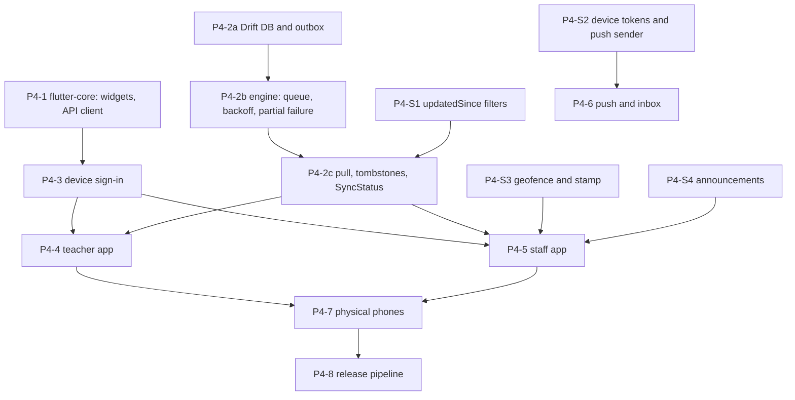

# Phase 4 Plan: Teacher and Staff Mobile (offline-first)

> Status: **accepted, 2026-10-27.** Product decisions are in ADR-0014 (owner answers 2026-10-27). Task IDs follow `implementation_plan.md` Phase 4; changes are marked **CHANGED** / **NEW**. Update statuses here as work lands.

**Phase goal (unchanged):** staff do their daily work with no connectivity and never lose data.

## 1. Starting point (verified 2026-10-27)
| Fact | Evidence |
|---|---|
| Phase 3 is built; its gate page is `documentation/phase3_gate.md` | the gate suites were rerun after the merge (see that page for the result) |
| The server half of offline sync exists: idempotent submissions, tombstones, written conflict rules | `documentation/modules/offline-sync.md`; `GET /v1/sync/tombstones`; `submissionId` on attendance and marks, `clientId` on leave requests |
| The Flutter side is a shell | `packages/flutter-core/lib/flutter_core.dart` exports only locales, localization, theme, tokens and `OruFormat`; `pubspec.yaml` has no Drift, connectivity, secure storage, Firebase or HTTP dependency; `apps/mobile-teacher` and `apps/mobile-staff` hold a themed foundation screen |
| The 18 design-system widgets are not written in Dart | the library header says they "arrive in Phase 4"; the React twins are in `packages/shared-ui` |
| Tooling is present | Flutter 3.47.5 and Dart installed; CI job `flutter` in `.github/workflows/periodic-checks.yml`; Melos workspace |
| No server support yet for | device tokens and push, an `updatedSince` filter on lists, a school geofence and a check-in stamp, announcements |
| No physical phone, no FCM project, no store accounts | owner items in section 6 |

## 2. How each part is built
1. **Server additions** follow the Phase 3 shape: a Data Connect operation with `$schoolId` and an actor check, the audit row in its own `@transaction`, a DTO-validated gateway route with `@Permission` and `@Audit`, real-emulator tests, the generated matrix, regenerated `openapi.json` and typed client.
2. **Dart code** is tested at the unit level (`melos run test`) and the sync engine is also run against the **real gateway and emulators** from a Dart test harness (the same "real, not mocked" rule as the gateway). Library versions and APIs are read from `pubspec.lock` and the package docs before use.
3. **Every string** is a `packages/i18n` key; Hindi and Urdu stay drafts; right-to-left and 48 px targets are checked by widget tests.
4. **Screens** are built per slice, each with a screenshot (`flutter test` golden or simulator capture) put in the Project Hub, as in Phase 3.
5. **No blocking spinners** on core flows (the local database is what the screen shows). Sign-in and the payment-like actions that need the network say so in words.

## 3. Workstreams

## 4. Tasks
### M1 Foundations
| ID | Task | Size | Acceptance |
|---|---|---|---|
| P4-1a BUILT (16 widgets plus a link action in `packages/flutter-core/lib/src/widgets`, named `Oru*` to avoid Material's `Card`, `Checkbox`, `TextField` and `Badge`; the six sync states take their wording from the catalogue; widget tests cover 48/64/112 px targets, 13 px text, Urdu right to left, no overflow at 360 px width; found and fixed two real faults while testing: the stat card's trend row overflowed and the neutral action tile asserted; **not built:** `SideNav` (web only) and `Logo` (needs the brand artwork, with the splash screen in P4-3)) | **Widgets** in `flutter-core`: the 18 components with the names, props and wording of the design system (batches as in the React library), icons through the Lucide map, touch density 48 (Driver 64 later) | XL | a widget test per component; nothing under 13 px or 48 px; right-to-left mirrors; no hex or literal copy (the drift rule checks) |
| P4-1b BUILT (the Dart client is GENERATED from `openapi.json` for the 38 operations the two apps use, listed in `packages/api-client/scripts/dart-operations.json`: 84 models and a typed `OruApi`, error codes, and a route table with each route's access class; `npm run generate:dart -w @oruschools/api-client`, and `npm test` fails if it is stale; the hand-written `OruHttpTransport` sends the token and school as the web client does, retries a 401 once with a fresh token, and turns the envelope, a timeout and no network into `OruApiError`; 19 unit tests, and `tools/tests/dart-gateway.sh` ran the client against the REAL gateway and emulators with the demo school: 3 tests parse real teacher and admin payloads and the refusals; it found and fixed a real gateway fault: `/v1/me` returned school ids without dashes, which the `X-School-Id` header refuses) | **API client and error handling** in `flutter-core`: a Dart client for the gateway's closed error list, generated or hand-written from `openapi.json` (decide in the task; if hand-written, a test fails when `openapi.json` changes without it), request id, school header | L | the client calls `/v1/me` against the real gateway in a test; each error code maps to one message key |
| P4-2a | **Local database and outbox**: Drift schema for the entities the two apps show; outbox table (UUID, kind, body, `createdAt`, attempts, state) | L | migrations tested up from an empty and a previous version; the outbox survives a process kill (test) |
| P4-2b | **Sync engine, push side**: connectivity watcher, exponential backoff with jitter, send oldest first, parents before children, one failing item never blocks the rest (a 4xx is final and surfaced; a 5xx or timeout retries) | XL | **E-SYNC-1 to E-SYNC-4** below |
| P4-2c | **Sync engine, pull side and `SyncStatus`**: pull by endpoint (`updatedSince` where added), apply tombstones, the six visible states with fixed wording | L | **E-SYNC-5**; the state shown always matches the queue (property test over random event sequences) |
| P4-3 | **Device sign-in**: Firebase sign-in, secure token storage, school choice, optional lock, a session that survives being offline until the token cannot refresh, sign-out deletes local data | M | tests with the Auth emulator; an expired token offline keeps the local data readable and refuses only new network work |

### M2 Server additions
| ID | Task | Size | Acceptance |
|---|---|---|---|
| P4-S1 **NEW** | `updatedSince` (server time) on the list endpoints a device pulls: class day attendance, marks of an exam, own leave requests, notifications, timetable | M | a list with `updatedSince` returns only what changed; rows removed appear as tombstones; the matrix covers the changed routes |
| P4-S2 **NEW** | **Device tokens and the push sender**: `POST/DELETE /v1/devices`, a table of tokens per account, an FCM sender behind the existing notification sender interface, a notice also triggers a push (best effort, never blocks the cause) | M | a token belongs to its account only; sign-out removes it; a failing sender cannot roll back the notice (test); push carries the id only (ADR-0014 decision 7) |
| P4-S3 **NEW** | **School geofence, check-in stamp and reason**: a point, a radius and a feathered margin (soft ring, default margin 50 m) in the school settings, and a fixed hard ring of 500 m; check-in and check-out accept an optional position, the phone's own time (`deviceTime`, a note) and a reason; the server stores `inside`, `outside` or `unknown`; beyond 500 m HR must confirm (ADR-0014 decision 9) | M | a repeat check-in is still the same answer; a stamp other than `inside` without a reason is refused by the gateway; HR sees stamp, reason and both times; no position is kept beyond the stamp and its distance |
| P4-S4 **NEW** | **Announcements**: written by the Principal and the Academic admin on the web, read by every staff role, delivered as notices | M | write is Principal/Academic admin only; every role reads; a notice per reader is written in the same transaction |

### M3 The apps
| ID | Task | Size | Acceptance |
|---|---|---|---|
| P4-4a | `mobile-teacher` **Today**: the teacher's next lessons from the local timetable, classes still without attendance today, pending leave | L | works with the network off after one sync; the six states show |
| P4-4b | **Attendance**: "Mark all present" then toggle exceptions; submit queues with a `submissionId`; a locked day is shown read-only | L | **E-SYNC-1** end to end from the phone UI; no spinner |
| P4-4c | **Gradebook fast entry** with drafts: marks per exam, tenths, absent; queued with a `submissionId` | L | a mark above the maximum is refused on the device with the server's rule when it syncs; drafts survive a kill |
| P4-4d | **Classes, leave request, substitute status**: own classes and report-card view (read), a leave request with a `clientId`, the cover duty list | M | a leave request made offline is sent once |
| P4-5 | `mobile-staff`: Home, Attendance (check-in/out with the stamp), Leave, Announcements (read-only), More; the Principal's leave approval (online only) | L | a check-in made offline syncs once; the server clock decides the time (offline-sync rule 4) and the phone time is sent as a note; outside the soft ring the app asks for a reason first |
| P4-6 | **Push registration and inbox**: register the token after sign-in, open the inbox from a push, the inbox cached for offline reading | M | a notice arrives as a push, is read from the cache with the network off |
| P4-7 | **Physical-phone testing** (carried from P1-0c): 2G throttling, airplane mode, a low-end Android, app kill mid-sync, clock skew, Urdu right-to-left, 64 px targets for the Driver app's first screen | L | the E-SYNC list repeated by hand on real phones with the result recorded; needs real phones and store accounts (ADR-0014 decision 12: none yet; stays open) |
| P4-8 | **Release pipeline**: flavors, signing, Fastlane or CI, Crashlytics, TestFlight and an internal track; per-app icons from `brand-assets`; the white-label Mode A rules | L | a signed build of each app uploaded from CI to the internal track; needs real phones and store accounts (ADR-0014 decision 12: none yet; stays open) |

## 5. Gate (the phase closes only when all pass)
- **E-SYNC-1:** attendance taken with the network off syncs once when it returns; replaying the queued item any number of times leaves one result.
- **E-SYNC-2:** the queue survives the app being killed mid-sync and resumes without loss or duplicates.
- **E-SYNC-3:** one failing item (a refused 4xx) does not block the items behind it, and is shown to the person.
- **E-SYNC-4:** two devices changing the same record resolve by the written rule for that entity, the same way every time (a deterministic test with both orders).
- **E-SYNC-5:** the sync state shown is always one of the six and always matches the queue; a removal on the server removes the record on the device (tombstone).
- **E-MOB-1:** `melos run analyze` and `melos run test` green; no literal copy, hex colour or dark-theme code (drift rules), 48 px targets and right-to-left proved by widget tests.
- **E-RBAC-FULL:** every new route (devices, announcements, check-in stamp, `updatedSince`) is in the generated matrix; E-AUD-1 for every new write.
- Physical-phone results recorded (P4-7) or listed under "not proven"; a gate review page `phase4_gate.md`; `CLAUDE.md` "Current reality" and the Hub updated.

## 6. Risks
| Risk | Mitigation |
|---|---|
| The sync engine loses or duplicates a change on a rare timing | the server already makes every submission safe to repeat; the engine is tested against the REAL gateway with injected failures (drop the reply, kill the process) and a deterministic random schedule |
| The Dart client drifts from the API | generate it from `openapi.json` or add a test that fails on any change to it |
| Drift/SQLite migrations lose data on update | migration tests from every earlier version; the outbox is never dropped by a migration |
| Offline check-in time vs the server clock (rule 4) | decided: the server's time is the record and the phone time is kept as a note (ADR-0014 decision 10); HR can correct with an audit row |
| A faked position passes the geofence | the stamp is evidence for HR, not enforcement; a reason is asked outside the rings (ADR-0014 decision 9) |
| No physical phones before the gate | P4-7 stays open and is stated; the apps are proven on simulators and the real gateway meanwhile |
| Scope (two apps plus an engine plus push) | vertical slices as in Phase 3; the staff app follows the teacher app; tasks and the Driver app are Phase 5 |

## 7. Open items for the owner
Answered 2026-10-27 (ADR-0014 decisions 9 to 12); nothing blocks the build.
1. ~~Two rings~~ **confirmed:** soft ring is the school plus a feathered margin, hard ring is 500 m (ADR-0014 decision 9).
2. **Later, when the app is ready for phones:** a Firebase project with Cloud Messaging, Apple and Google Play accounts, two real phones (one low-end Android, one iPhone). Until then P4-6 push delivery, P4-7 and P4-8 stay open.
3. From the Phase 3 gate: browser click-through of the web screens, the production schema deploy, Hindi and Urdu review.
