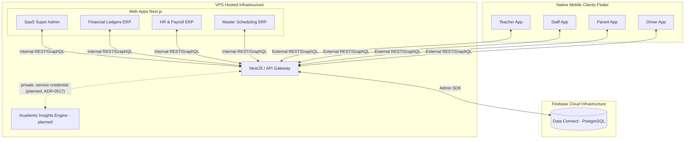

# System Architecture

## Executive Summary
OruSchools utilizes a **Two-Pillar Architecture** to serve as both an Enterprise ERP (System of Record) and a Communication Bridge (System of Engagement). The system is built offline-first for mobile users to handle regions with unpredictable internet connectivity.

## The Two Pillars

### 1. Enterprise ERP (Web Admin)
- **Tech Stack:** Next.js (React), TypeScript
- **Purpose:** Complex, heads-down administrative workflows.
- **Key Modules:**
  - Financial Ledgers & Payroll
  - Master Scheduling & Timetables
  - Admission Setup
  - System Configuration & RBAC

### 2. Communication Bridge (Mobile Ecosystem)
- **Tech Stack:** Flutter, Dart
- **Purpose:** Everyday user engagement, highly optimized for iOS and Android.
- **Applications:**
  - **Staff App:** For non-teaching employees (HR, Office Staff). Handles personal attendance, tasks, and leave requests.
  - **Teacher App:** For teaching staff. Highly workflow-intensive (Gradebook, Student Attendance, Exceptions-based input).
  - **Parent Portal:** Real-time notifications, live bus tracking, fee payments.
  - **Driver Utility:** Live GPS, student manifests. Features a "Driver Safety" density (very large tap targets).

## Core Infrastructure & Deployment
- **VPS Deployment Model:** The entire web ecosystem (SaaS Admin, Web ERP, Landing Page) and the **API Gateway** (NestJS) are self-hosted on a central VPS server. They are accessed via the VPS IP or associated DNS records (routed through a reverse proxy like Nginx).
- **API Gateway (NestJS):** The absolute central hub for *all* business logic, rate-limiting, and auditing.
- **Database Layer:** Firebase Data Connect (Multi-Tenant PostgreSQL). 
  - *Constraint:* **No client application** (including Mobile Flutter apps) is permitted to connect directly to the database. All queries and mutations MUST be routed through the API Gateway, which utilizes the Firebase Admin SDK to communicate with the DB.
- **Monorepo Management:** Turborepo for JS/TS (Next.js, NestJS), Melos for Dart (Flutter).

- **Academic Insights Engine (planned, ADR-0017, proposed):** a second NestJS service for student progression and growth analytics (mastery, benchmarks, risk bands, the school's calendar profile and the NEP 2020, state and board policy packs). It is a compute service on a private address: **only the gateway calls it**, with a service credential and the verified `schoolId`; **it never touches the database**, it reads internal gateway feeds and the gateway stores its snapshots. If it is down, apps show the last snapshot with its time. Not built; see `documentation/modules/academic-insights-engine.md`.

## Architecture Diagram

## Shared Platform (Design & Tokens)
While the Web ERP and Mobile apps use separate frontend frameworks (React vs Flutter), they rely on a shared foundation of permissions, identity, and a global **OruSchools Design System** maintained via JSON Design Tokens.
