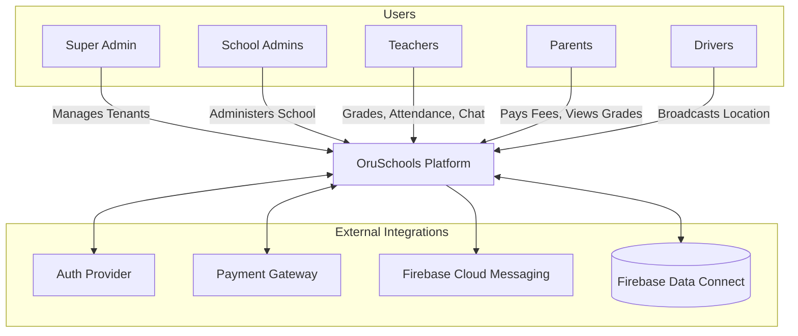

# System Context & Integrations

## System Actors

1. **Super Admin (SaaS Owner):** Manages school subscriptions, billing, and global tenant configurations.
2. **School Administrators (Principal/Director):** Full read access, dashboard views.
3. **Finance Admins (Bursar):** Full CRUD on financial data and payroll.
4. **Academic Admins:** Full CRUD on academics, schedules, and attendance.
5. **Teachers:** Input attendance, grades, and communicate with parents (bound by office hours).
6. **Parents / Students:** Consume academic data, receive broadcasts, pay fees, track buses.
7. **Transport Drivers:** Provide live GPS tracking and manage bus rosters.
8. **HR Manager:** Staff records, staff attendance, leave balances (never approves), payroll preparation, recruitment.
9. **Accountant:** Day-to-day fees, payments, expenses and ledger (cannot delete records, no payroll).
10. **Admissions Officer:** Applications and student enrolment.
11. **Transport Manager / Operations Manager:** Vehicles, routes and drivers / inventory, assets, procurement and visitors.
12. **Management (trustees, owners):** Dashboards and reports only.
13. **Non-teaching Staff:** Check in, tasks, own leave (Staff app).

*All roles, their limits and the reasoning: ADR-0007 and `packages/rbac`.*

## External Systems & Integrations

- **Authentication:** Firebase Auth (ADR-0002); the gateway verifies ID tokens and resolves the school role from `SchoolMember`.
- **Database:** **Firebase Data Connect**, which provisions and manages the underlying PostgreSQL instances and generates typed SDKs.
- **Payments:** Stripe or Razorpay for parent fee payments (integrated into both Web and Flutter apps).
- **Communications:** FCM (Firebase Cloud Messaging) for push notifications and SMS Gateways for fallback alerts.
- **Storage:** Edge Object Storage (S3 or Firebase Cloud Storage) for assignments, profile pictures, and documents.

## Context Diagram

