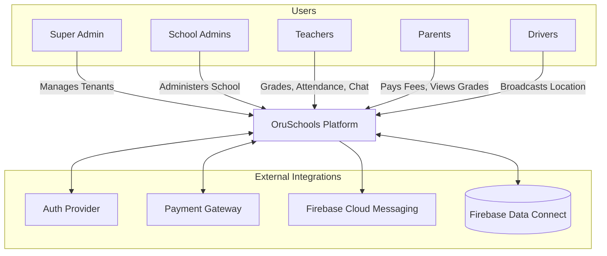

# System Context & Integrations

## System Actors

1. **Super Admin (SaaS Owner):** Manages school subscriptions, billing, and global tenant configurations.
2. **School Administrators (Principal/Director):** Full read access, dashboard views.
3. **Finance Admins (Bursar):** Full CRUD on financial data and payroll.
4. **Academic Admins:** Full CRUD on academics, schedules, and attendance.
5. **Teachers:** Input attendance, grades, and communicate with parents (bound by office hours).
6. **Parents / Students:** Consume academic data, receive broadcasts, pay fees, track buses.
7. **Transport Drivers:** Provide live GPS tracking and manage bus rosters.

## External Systems & Integrations

- **Authentication:** Managed via robust Auth providers (e.g., Auth0 or Firebase Auth) for secure, token-based API access.
- **Database:** **Firebase Data Connect**, which provisions and manages the underlying PostgreSQL instances and generates typed SDKs.
- **Payments:** Stripe or Razorpay for parent fee payments (integrated into both Web and Flutter apps).
- **Communications:** FCM (Firebase Cloud Messaging) for push notifications and SMS Gateways for fallback alerts.
- **Storage:** Edge Object Storage (S3 or Firebase Cloud Storage) for assignments, profile pictures, and documents.

## Context Diagram

