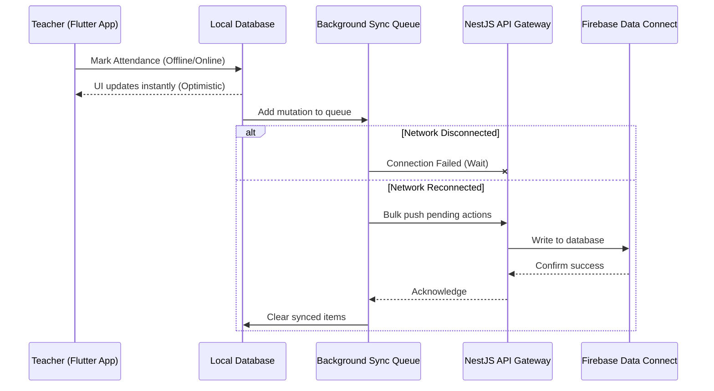

# System Memory & Data Flow

## Offline-First Sync Architecture

Given the target demographic (e.g., regions with unpredictable internet such as Jammu & Kashmir), the mobile ecosystem relies heavily on an offline-first architecture. 

Users should never be blocked by loading spinners while waiting for an API response.

### Core Mechanisms
1. **Local Database:** Flutter apps utilize local databases (Drift on SQLite, ADR-0003) as the primary source of truth for the UI.
2. **Optimistic Updates:** UI updates instantly based on local database writes.
3. **Background Sync Queue:** Mutations (e.g., marking attendance) are added to a local queue.
4. **Cloud Sync:** When network connectivity is restored, the queue bulk-pushes pending actions to the NestJS API Gateway, which writes to Firebase Data Connect (PostgreSQL).
5. **Acknowledgment:** Upon successful write, the cloud acknowledges, and the local queue clears the synced items.

## Offline Sync Flow

## Data Isolation (Multi-Tenancy)

OruSchools operates as a SaaS platform with isolated data per tenant (school) to ensure strict privacy.
- The system uses a **Single Cloud Database (PostgreSQL via Firebase Data Connect)**.
- All schools share one schema; every tenant row carries a `schoolId` and every query filters on it (ADR-0001).
- System-wide Super Admin tables track tenant provisioning and subscription states.
